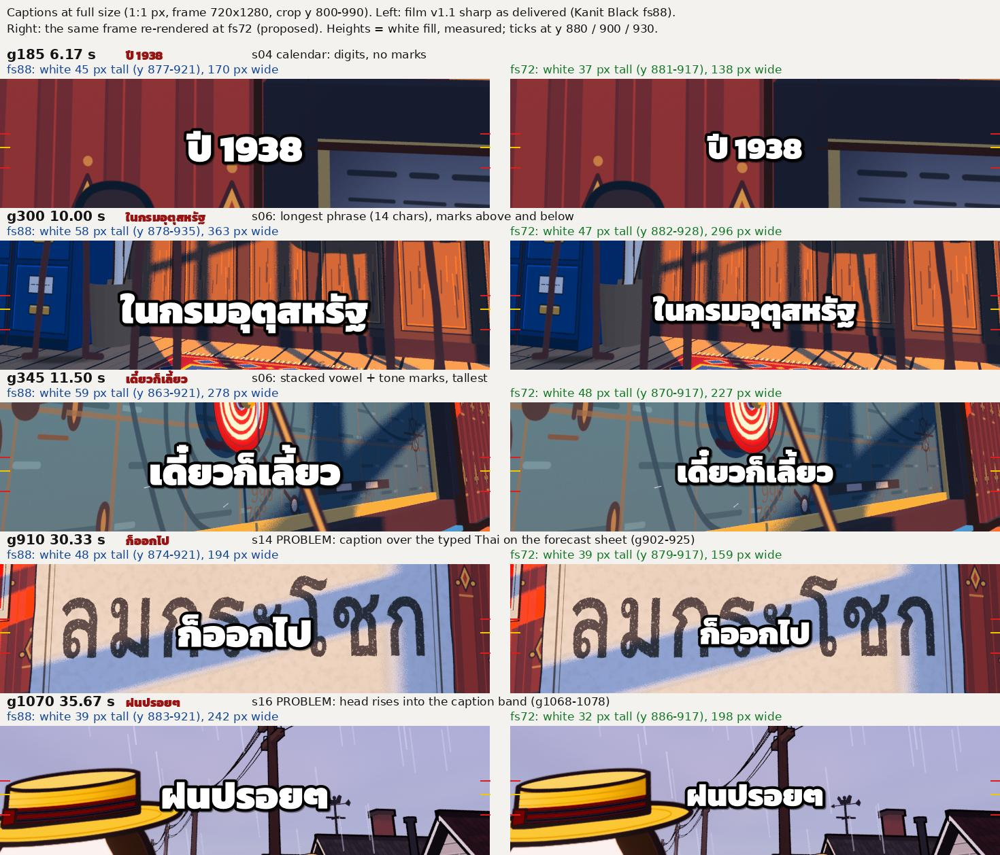

# Captions, voice, music and sound effects

Style bible chapter. Paths: `pipeline/...` is the skill's bundled pipeline folder (run every command from inside `pipeline/`); `__PROJ__/...` is the film-1 project folder, which is NOT bundled (narration, music and effect WAVs live there; a new film makes its own). Sizes are px on the 720x1280 frame. Times are seconds on the film clock; frames g are 0-based at 30 fps (g = round(t x 30)).

## The rules in brief

1. One caption line, white fill, 4 px black stroke, centred at (360, 900), hard swap, no animation, burned last on top of everything with `pipeline/assemble.py ... 30`.
2. Thai captions: Kanit Black through the override `{\fnKanit Black\fs88}` (film 1); fs88 reads 45 px tall against the reference's 36-37 px. Next film: show fs88 and fs72 on the opening and let the user choose (on `ปี 1938`: fs88 = 45 px, fs72 = 37 px).
3. Each sentence has two texts: `tts` (what the voice says, numbers spelled out) and `captions` (4 to 14 Thai characters each, digits allowed, every pause of the tts on a caption boundary).
4. Caption times come only from `narration_timing.json` plus the voice offset 0.100 s. A phrase stays until the next one starts.
5. Voice wall to wall, laid at +0.100 s, active RMS -17.4 dBFS. Bed (music) -38 dBFS RMS from frame 0 to the end. Nothing but the voice over -10 dBFS peak while the voice speaks.
6. Point effects after the opening: one every 2.3 to 3 s, each rendered peak at or under -11 dBFS. Beds (ambiences): -34 to -30 dBFS RMS, peak at or under -14.
7. Every effect comes from a take's cue (`cues.json`, kind + label); thin to the strongest cue in each 1 s; repeated figures get one sound.
8. Measure every generated effect: some come back nearly silent or with a 27 dB crest. Mix in floating point, limit after summing (limiter 0.89).
9. Measure the mix (`check_mix.py`, recipe 4.4) and ask the user to listen (recipe 4.5). You cannot hear it.

---

## 1. Reference (measured)

### 1.1 Captions

| Property | Reference value | Source |
|---|---|---|
| Font character | heavy geometric grotesque; closest free match Work Sans Black (weight 900), 0.9 % mean width error over 4 phrases; double-storey g, square dots | spec/captions.md |
| Size | 50 px font size in the spec's own measure; ascender-height word "called" = 36 px tall fill; score.py text height 36 (A) and 37 (B) px. In libass with the Pop style line below, that height needs `{\fs58}` (measured in this chapter, see "English specifics" in 2.1) | spec/captions.md, QA_film.md 1.1 |
| Fill | pure white #ffffff | spec/captions.md |
| Stroke | black #000000, 4 px each side | spec/captions.md |
| Shadow | soft dark halo about 2-3 px beyond the stroke, low opacity | spec/captions.md |
| Caption black vs scene black | caption black luma 0.001; darkest scene pixels (p0.5) 0.087 (A), 0.079 (B) | spec/color_light_post.md |
| Position | centred, centre x 359.5-360; centre of the text line y 900 (70.3 % of the height) | spec/captions.md, QA_film.md 1.5 |
| Words per caption | 1 to 3 words, mean 1.24-1.34; sentence case, punctuation kept | spec/captions.md, QA_film.md 1.5 |
| How long each stays | 0.2 to 0.6 s (6 to 18 frames), median 11 frames | spec/captions.md, QA_film.md 1.5 |
| How they change | hard swap; full size on the first frame (98-99 % of captions); width constant over every frame of a phrase; no pop, no fade | spec/captions.md, QA_film.md 1.5 |
| Share of frames with a caption | 96-100 % | QA_film.md 1.5 |
| Safe band | every head centre above y 880; 91 % of heads fully above it. The caption line crosses the chest in close shots, legs in medium shots, the ground in wides. The look measurements mask the caption band y 850-950 (or 850-960), x 120-600 | spec/camera_motion.md, spec/color_light_post.md, spec/environment_materials.md |

### 1.2 Voice

Measured in this chapter on `__PROJ__/audio/refaudio/` (speech-to-text word times `a.asr_events.json`, `b.asr_events.json`; stems from `fal-ai/demucs`).

| Property | Clip A | Clip B |
|---|---|---|
| Duration / words | 65.22 s / 214 words | 64.90 s / 235 words |
| First word starts / last word ends | 0.12 s / 64.98 s (0.24 s before the end) | 0.12 s / 64.82 s (0.08 s before the end) |
| Pace | 3.30 words/s; about 5.0 syllables/s (inferred: vowel-group count) | 3.63 words/s; about 5.1 syllables/s (inferred) |
| Pauses between words of 0.15 s or more | 26, 4.86 s in all | 45, 8.84 s in all |
| Longest pause | 0.30 s | 0.30 s |
| Voice level (vocals stem, RMS over 50 ms windows above -40 dBFS) | -17.2 dBFS | -17.2 dBFS |
| Whole mix | RMS -16.9 dBFS, peak -2.4 dBFS | RMS -16.8 dBFS, peak -2.2 dBFS |

The skill and the briefs use -17.4 dBFS as the voice target (an earlier measurement); this chapter's measurement gives -17.2. Either is inside the tolerance the reviews used.

### 1.3 Music bed

| Property | Reference value | Source |
|---|---|---|
| Kind | no drums, no clear beat, steady level, mid and low spectrum | references/audio.md, analysis.md |
| Level (everything but the vocals stem, per-second RMS median) | -38.0 dBFS (A), -38.3 (B); p10 -39.2 / -40.7; p90 -34.7 / -28.9 (effects raise the upper end) | measured here |
| Under the voice | about 21 dB (voice -17.2, bed -38) | measured here |
| Where it starts | from the first frame: non-vocal RMS in 0-0.5 s is -40.1 (A), -37.5 (B) | measured here |
| Where it ends | runs to the end; last 1 s -30.1 (A, a louder ending, cause not established) and -39.2 (B) | measured here |
| Drums stem | -47.3 (A), -39.8 (B) dBFS RMS overall; effect impacts land in it; no beat was found | measured here, analysis.md |

### 1.4 Effects, ambiences, silence

| Property | Reference value | Source |
|---|---|---|
| How often | 21 (A) and 25 (B) effects per 65 s clip, i.e. one every 2.5 to 3 s; found as gaps between words that are louder than the bed | analysis.md |
| Levels | peaks between -24 and -12 dBFS | analysis.md |
| What they are tied to | visible actions and camera snaps (the reason the takes write cue lists) | references/audio.md |
| Ambiences | not separated from the effects in the reference measurements (not established) | - |
| Silence | none: the voice runs wall to wall from 0.12 s; the longest pause is 0.30 s | measured here |

---

## 2. Our build (film 1)

### 2.1 Caption pipeline: script to burned picture

**Step 1. Two texts per sentence** (`pipeline/script_th_v2/script_th.json`, 21 sentences, 104 captions, 313 syllables):

```json
{"beat": "pivot", "element": [2],
 "tts": "คืออย่างนี้ กันยายน ปีหนึ่งเก้าสามแปด เฮอริเคนลูกหนึ่ง จ่ออยู่นอกฝั่งฟลอริดา",
 "captions": ["คืออย่างนี้", "กันยายน", "ปี 1938", "เฮอริเคน", "ลูกหนึ่ง", "จ่ออยู่", "นอกฝั่ง", "ฟลอริดา"],
 "syllables": 23, "syl": "คือ อย่าง นี้ ...", "gloss_en": "You see: September 1938. ..."}
```
Top-level field `caption_number_readings` maps caption digits to the spoken words (`{"1938": "หนึ่งเก้าสามแปด", "120": "ร้อยยี่สิบ", "100": "ร้อย"}`); the speech-to-text check and the aligner use it.

**Step 2. How phrases are cut (Thai rules film 1 enforced, from `__PROJ__/script_th_v2/final_check.py`):**

| Rule | Value |
|---|---|
| Length | 4 to 14 Thai characters (without spaces and quotes); 14 at most with quotes removed. Film 1: min 4, median 9, max 14 (8 captions at 14: `ในกรมอุตุสหรัฐ`, `เดี๋ยวก็เลี้ยว`, `ลูกไหนก็เลี้ยว`, `แถบนิวอิงแลนด์`, `ไม่โดนเฮอริเคน`, `จนทั้งตึกเรียก`, `ความกดอากาศสูง`, `เหลือช่องเดียว`) |
| Visible letters | at least 4 base letters (vowel and tone marks, category Mn, do not count) |
| Rejoin | the captions joined, digits read as words, equal the tts (spaces and quotes ignored) |
| Pauses | every space in the tts (a spoken pause) falls on a caption boundary |
| Word boundaries | a caption never splits a word (checked with pythainlp `word_tokenize(engine="newmm")`; proper nouns เฮอริเคน นิวยอร์ก ลองไอแลนด์ นิวอิงแลนด์ ฟลอริดา บอสตัน whitelisted) |
| Characters | no Latin letters, no leading or trailing space; last character Thai, a digit, `”`, `?` or `!` |
| Digits | allowed where a viewer expects them: `ปี 1938`, `120 กว่าปี`, `เกือบ 100` |
| Quotes | “ ” kept in the captions exactly as in the tts (`“ไอ้หนู` ... `ทางด่วนหรอก”`) |
| Spaces | 3 of 104 captions contain one (`ปี 1938`, `120 กว่าปี`, `เกือบ 100`) |

**Step 3. Times from the narration.** `tts_fal.align()` (`pipeline/audio/th/tts_fal.py`) strips spaces and punctuation from the spoken character stream and the joined captions, matches them with `difflib.SequenceMatcher` (unmatched spans, such as digits against spelled numbers, are spread linearly), and gives each caption the start time of its first character. `t1` of a phrase = `t0` of the next; the last phrase holds 0.35 s past the last character. Film 1: 104 phrases, match ratio 0.98, phrase duration 0.20-1.20 s, median 0.62 s (18.5 frames), mean 0.63 s.

**Step 4. Burn list.** `caps_burn.json` = the phrases with the voice offset added and the font override in front:
```json
[{"t0": 0.1, "t1": 0.598, "text": "{\\fnKanit Black\\fs88}เขาลากเส้น"}, ...]
```
The first caption appears at 0.100 s (g 3); the last ends at 65.500 s, the last frame. Frames 0-2 have no caption; every later frame has one.

**Step 5. The style line** (written by `pipeline/assemble.py`; identical in `film_silent.ass`):
```
[Script Info]  PlayResX: 720  PlayResY: 1280  WrapStyle: 2
Style: Pop,Work Sans Black,50,&H00FFFFFF,&H00FFFFFF,&H00000000,&H80000000,0,0,0,0,100,100,0,0,1,4,1.5,5,40,40,0,1
Dialogue: 0,0:00:00.10,0:00:00.60,Pop,,0,0,0,,{\pos(360,900)}{\fnKanit Black\fs88}เขาลากเส้น
```
Fields: fill white `&H00FFFFFF`, outline black `&H00000000`, shadow colour black at 50 % (`&H80000000`), BorderStyle 1, Outline 4 px, Shadow 1.5 px, Alignment 5 (middle centre), MarginL/R 40, `\pos(360,900)` on every line. The per-line override switches the face to Kanit Black at size 88; the base style (Work Sans Black 50) is the English setting. The code adds no animation (the bundled `assemble.py` says so in its comment; film 1's project copy still carried a stale comment about a pop-in).

**Step 6. Font files:** `pipeline/fonts/Kanit_900Black.ttf` (family "Kanit Black", Thai + Latin) and `pipeline/fonts/WorkSans-Black.ttf` (family "Work Sans Black"). `assemble.py` passes `fontsdir=<its own folder>/fonts`. Full Thai+Latin fonts come from npm `@expo-google-fonts/<family>`; `@fontsource` packages ship per-script subsets only (references/audio.md).

**Step 7. The burn command.** `assemble.py` reads `f_%04d.png` starting at `f_0001`, but the conformed or graded frames are `g_%04d.png` from `g_0000`. Film 1 made a folder of links (`work/flink/f_0001.png -> ../../graded/g_0000.png`, 1965 links) and ran:
```
python3 assemble.py <flink_dir> film_silent.mp4 caps_burn.json 30
# = ffmpeg -y -framerate 30 -i <flink_dir>/f_%04d.png -vf ass=film_silent.ass:fontsdir=pipeline/fonts \
#     -c:v libx264 -pix_fmt yuv420p -crf 18 -movflags +faststart film_silent.mp4
```
The bundled `assemble.py` defaults to 30 fps (film 1's project copy defaulted to 24); pass 30 explicitly anyway. The film of record (`deliver/film_v1_1_sharp_thai.mp4`) burned the same `film_silent.ass` with the same ffmpeg settings, with the frames piped straight into the encoder by `pipeline/v3/film/out_v11/make_sharp.py` (bundled; film 1's SRC, ASS, N = 1965 and OUT are written in) instead of through a link folder. Captions go on after the dissolves, overlays and grade, so they keep true black and white.

**English specifics (the reference's own language).** The style line's base size 50 renders too small in libass. Measured for this chapter: English phrases (`they called it`, `the storm`, `straight north`) burned with `assemble.py` and the Pop style line on graded frames g291-335, then `score.py` on the clip: `{\fs50}` 32 px text height, `{\fs56}` 36, `{\fs58}` 36 (stroke 3.8 px), `{\fs60}` 38, `{\fs66}` 42, `{\fs70}` 44 px. Use **`{\fnWork Sans Black\fs58}`**: 36 px, the reference's 36-37, with a stroke inside the 3.6-4.4 px range. Phrases: 1-3 words (mean 1.24-1.34), 0.2-0.6 s each (median 11 frames), sentence case, punctuation kept (1.1). Burn: `python3 examples/film_mini.py captions <out> caps.json --style en [--frames graded]`, or prefix the override yourself in `caps_burn.json` for `assemble.py`.

**Thai specifics: the size question.** Measured on our frames by rendering each phrase with the style line above on the captionless graded frame of the film of record (`out_v11/graded/`, sharp; re-measured with the bundled fonts, same numbers):

| Phrase (g) | What it tests | fs88 white fill: height (rows), width | fs88 ink incl. stroke (rows) | fs72 white fill: height (rows), width |
|---|---|---|---|---|
| `ฝนปรอยๆ` (g1070) | no marks above or below | 39 px (883-921), 242 px | 878-928 | 32 px (886-917), 198 px |
| `ปี 1938` (g185) | digits, one mark | 45 px (877-921), 170 px | 872-928 | 37 px (881-917), 138 px |
| `ก็ออกไป` (g910) | one stacked mark | 48 px (874-921), 194 px | 869-928 | 39 px (879-917), 159 px |
| `ทางด่วนพายุ` (g1145) | mark below (ุ) | 55 px (881-935), 300 px | 876-942 | 45 px (884-928), 246 px |
| `ในกรมอุตุสหรัฐ` (g300) | longest (14 chars), marks above and below | 58 px (878-935), 363 px | 873-942 | 47 px (882-928), 296 px |
| `เดี๋ยวก็เลี้ยว` (g345) | vowel + tone stacked, tallest | 59 px (863-921), 278 px | 858-928 | 48 px (870-917), 227 px |

- At fs88 the film's captions read 45 px tall on the review tool against the reference's 36-37 px: about 25 % taller and heavier (QA_film.md 1.5). The review's estimate "fs72 gives about 36 px" is confirmed: `ปี 1938` measures 37 px at fs72.
- The whole caption, stroke included, occupies y 858-942 at fs88 and y 865-935 at fs72. Keep about 80 px around y 900 clear of faces and of text in the picture (y 858-942 measured).
- The widest phrase is 363 px at fs88 (fill), well inside 720; width never forced a line break (WrapStyle 2 = no wrapping).
- Picture: `../../assets/bible/captions_sizes.jpg` (left: fs88 as in the delivered film `film_v1_1_sharp_thai.mp4`; right: fs72 on the same frame; ticks at y 880 / 900 / 930; the two problem frames of section 5 included).



**Our build against the reference:** position, fill and stroke match (centre 359.5 / 899.5; 4.0 px stroke). Our captions stay longer (median 18 frames against 11) and hold one Thai phrase (1.03 "words" per caption against 1.24-1.34), because the Thai phrase is the unit. Size is the one miss (45 against 36-37 px); fs88 was the client's choice and stayed in v1.1.

### 2.2 Narration pipeline

| Step | Film 1 value | Code |
|---|---|---|
| Speech service | fal.ai `fal-ai/elevenlabs/tts/eleven-v3`, fields `text, voice, language_code "th", timestamps true, speed`; answer has per-character start/end times | `pipeline/audio/th/tts_fal.py synth()` |
| Voice | a native Thai voice the user picked by ear from samples (its name and id are written into `narration_timing.json` fields `voice`, `voice_id`) | - |
| Speed sent to the service | 1.2 | `--speed 1.2` |
| Chunks | the hook sentence alone, then paragraphs of 2-4 sentences that break where the beat changes, at most 320 characters. Film 1's groups were written by hand into `audio/th/build_narration_v2.py` and `build_narration_fit.py` (`GROUPS = [[0], [1,2,3], [4,5], [6,7], [8,9,10], [11,12,13], [14,15,16], [17,18], [19,20]]`); `--groups auto` on the same script gives `[0] [1,2,3] [4,5] [6,7] [8,9] [10,11] [12,13,14,15] [16,17,18] [19,20]` (tested with `--dry-run`: 1033 characters, chunks 68-211). A request of about 1,000 characters failed with HTTP 502; single sentences vary in delivery | `build_narration.py --groups auto --max-chars 320` (or `--groups "0|1,2,3|..."`) |
| Check | each take transcribed back with `fal-ai/elevenlabs/speech-to-text` (`language_code "tha"`), digits replaced by `caption_number_readings`, compared with `difflib` ratio; up to 3 takes per chunk, stop at 0.985, keep the best | `asr_ratio()` |
| Tighten | silences (20 ms RMS envelope under 0.012) over 0.14 s cut to 0.10 s; head trimmed to 30 ms before speech; tail kept 80 ms | `tighten()` |
| Join | chunk loudness matched to the median active RMS; 0.16 s gaps between chunks | `GAP = 0.16` |
| Fit the length | one `atempo` for the whole narration so it lands on `--target-s` (capped at 1.22, warning above 1.15), then `alimiter=limit=0.9` | `--target-s 65` |
| Film 1 result | 65.40 s; per-sentence tempos after the re-voice 1.097-1.289, median 1.204 | `narration_timing.json` `fit` |
| Pace | 313 syllables in 65.4 s = 4.79 syllables/s; 975 characters = 14.9 characters/s | script_th.json, narration.chars.json |
| Pauses (in the mix) | 9 pauses of 150 ms or more, 1.65 s in all, longest 0.25 s | QA_film.md 1.6 |

Files written to `<out_dir>` (film 1: `__PROJ__/audio/th/full_v2/`):

| File | Fields |
|---|---|
| `chunkNN.wav/.mp3/.json` | the chosen take of chunk NN (`.json` is the raw service answer with the audio URL) |
| `chunkNN.chars.json` | `text, chars[], t0[], t1[], duration, voice, speed, src_text, asr_match` |
| `chunkNN_takeK.*`, `.asr.txt` | every paid take and its transcript (cache: a re-run pays only for missing chunks) |
| `narration.wav` | 48 kHz mono, the voice laid into the mix |
| `narration.chars.json` | `text, chars[], t0[], t1[], duration, voice, speed, tempo` (whole narration) |
| `narration_timing.json` | `duration, audio, match_ratio, tempo` (new build) or `voice, voice_id, speed, fitted_to, fit[{sentence, tempo, new_len, slot}]` (re-voice), and `phrases[{text, sentence, beat, k, t0, t1}]` on the narration clock (no offset) |

**Re-voicing to an existing clock** (`pipeline/audio/th/build_narration_fit.py <voice_id> <voice_name> <out_dir> [speed=1.2]`): same chunks and checks; each chunk is cut between sentences at the quietest 20 ms in the 150 ms before the sentence's first phrase; each sentence is time-stretched (`atempo`) into the slot the same sentence has in the old narration (start of its first phrase to the start of the next sentence), with 4 ms fades; loudness set to the old active RMS; limiter 0.9; padded or cut to the old sample count. Every sentence start and the total length stay; caption phrases moved 0.05 s on average, 0.24 s at most. It reads the old clock from `audio/th/full_v2_oldvoice/` when that folder exists, otherwise from `audio/th/full_v2/`, and its sentence groups and number readings are film 1's (edit `GROUPS` and `NUM` for a new script). Only shots whose mouths follow the narration loudness need rendering again.

### 2.3 The film clock

| Item | Value |
|---|---|
| Voice offset | narration.wav laid at +0.100 s (`"voice": {"at": 0.1}`) |
| Caption on screen | phrase `t0 + 0.1` to `t1 + 0.1` |
| Frames | film frame g starts at g / 30 s; film 1 = 1965 frames = 65.500 s (narration 65.40 s + 0.1) |
| In-shot events | a narration time t falls on frame `round((t + 0.1) x 30)` |
| Shot boundaries | plan times t0/t1 fall on `round(t x 30)`: every cut leads its word by 3 frames (0.1 s) |
| Cue files | take cues are on the film clock (`time`), with `clock = time - 0.100` (the narration clock) |
| Mix entries | `at` is film-clock seconds; frame of an effect = round(at x 30) |

### 2.4 The mix specification and the mixer

`pipeline/audio/mixer.py <spec.json>` (48 kHz stereo, float64).

| Field | Meaning | Film 1 (v1.1) |
|---|---|---|
| `duration` | length of the mix in s | 65.5 |
| `out_wav` | the mix written here | `out_v11/film_mix.wav` |
| `video_in`, `video_out` | optional: mux the mix into this picture (video stream copy, AAC 192k, `-shortest`, `+faststart`) | the bundled v1.1 spec names `out_v11/film_silent_sharp.mp4` -> `deliver/film_v1_1_sharp_thai.mp4`, the film of record (`make_sharp.py` muxes the same `film_mix.wav` with the same settings) |
| `voice.file / at / gain` | voice WAV, start s, linear gain | `audio/th/full_v2/narration.wav`, 0.1, 1.3471317 (v1: 1.5115066 = 1 dB too hot) |
| `music.file / at / start / rms_db / fade_in / fade_out` | bed WAV, where it starts in the film, where in the file, target RMS (of the WHOLE file, not the used part), fades | `audio/music/music_fit.wav`, 0.0, 0.0, -38, -, 0.4 |
| `sfx[].file` | effect WAV (an mp3 is converted on load) | `audio/sfx/<name>.wav` |
| `sfx[].at` | film time of the effect's start | |
| `sfx[].peak_db` or `sfx[].rms_db` | target peak, or target RMS (of the part used); neither = RMS -26 | |
| `sfx[].align: "onset"` | trim the file to 5 ms before its first sample over 25 % of its peak, so the hit lands on `at` | impacts, thunder |
| `sfx[].start / len` | where in the file to start (after onset trim) / how much to use | |
| `sfx[].fade_in / fade_out` | linear fades; defaults 0.005 / 0.03 s | |
| `sfx[].pan` | -1..1; positive lowers the left channel (pan right) | -0.3 .. 0.4 |

Order inside the mixer: load each part, scale it, add all in floating point; if the sum peaks over 0.5, scale it down for the 16-bit intermediate; then ffmpeg restores the gain and limits: `volume=1/scale, alimiter=limit=0.89:attack=2:release=40:level=disabled`. Film 1: peak before the limiter 1.10, final peak -1.01 dBFS; the voice's own peaks are what the limiter catches.

Film 1's spec was built by `pipeline/v3/film/out/sound/build.py` (opening entries copied from `__PROJ__/v3/out/mix_opening.json`, then a hand list of ambiences and point effects, then the caps) and corrected for v1.1 by `pipeline/v3/film/out_v11/sound/build_v11.py`. Both scripts hold film 1's absolute paths: read them as examples; write a new spec for a new film.

### 2.5 The sound library

20 effects made with `pipeline/audio/sfx/make_sfx.py` through fal.ai `fal-ai/elevenlabs/sound-effects/v2` (`text`, `duration_seconds`, `prompt_influence 0.6`, `output_format mp3_44100_128`), converted to 48 kHz stereo WAV, measured into `manifest.json` (`name, prompt, asked, duration, peak, rms_db, onset, centroid_hz`). The WAVs are not bundled: regenerate with `python3 audio/sfx/make_sfx.py [name ...]` (paid, from the main conversation). Crest = raw peak minus raw RMS: an entry set by RMS peaks at about `rms_db + crest`.

| File | What it is (prompt) | Raw: dur s, peak dBFS, RMS dBFS, crest dB, centroid Hz | Typical use in film 1 | Typical level |
|---|---|---|---|---|
| `whoosh_fast` | short fast air whoosh, quick swish | 0.60, -0.1, -13.6, 13.5, 1955 | camera snaps, crash pushes and pull-outs, arm swings | peak -19 to -14, `len` 0.3-0.5 |
| `whoosh_whip` | very quick sharp whip-pan whoosh | 0.48, 0.0, -15.8, 15.8, 2372 | whip pans, whip-tilts, whip pull-outs | peak -13 (opening -11 / -10), pan +-0.3 |
| `thump_jab` | one deep punchy thud, fist on a wooden board | 0.60, -16.3, -29.6, 13.3, 164 | every impact: jab, stamp, label slap, wall boom, bonk, gust hit, orchestra-hit stand-in, footfalls | peak -12 (impacts), -11.1 (booms, hits), -14 (bonks), -15 (gust), -22/-23 (footfalls); `align onset`, `len` 0.25-0.4 |
| `pencil_scratch` | pencil drawing one long line, scratchy graphite | 1.60, -12.0, -31.6, 19.6, 5033 | pencil draws, chalk curve, pencil zip | RMS -27.5 to -26; opening -31 to -24 |
| `eraser_rub` | rubber eraser rubbing back and forth on paper | 1.60, -12.0, -30.2, 18.3, 6001 | erasing, eraser squeaks | RMS -28.3 to -28.1 (opening -25: peaked -7.8, too hot) |
| `map_marker` | felt marker quick stroke, short squeak | 0.68, -9.6, -26.8, 17.2, 8184 | pencil touch at the start of a draw | peak -16, `len` 0.12, `align onset` |
| `pop_surprise` | cartoon surprise pop with a tiny rising boing | 0.80, -0.3, -17.7, 17.4, 1695 | snap onto the shocked face | peak -11 (rendered -13.7 after `len`/fades) |
| `crowd_chuckle` | a few office men chuckling, short mocking laugh | 1.48, 0.0, -13.8, 13.8, 2016 | the seniors' laughter walla | peak -15, `len` 1.48 |
| `teletype` | 1930s teletype clattering and printing | 2.48, -6.3, -30.0, 23.7, 5344 | forecast feeding out of the machine | RMS -33.7 (capped from -28 to keep peak -11) |
| `whistle_tune` | a man whistling a short cheerful tune | 2.48, -0.4, -11.1, 10.7, 2280 | the chief strolls in whistling | peak -14, `len` 1.12 |
| `paper_slide` | one sheet of paper sliding on a table | 0.80, -17.4, -32.8, 15.3, 6895 | newspaper flutter, paper rustle | RMS -28 |
| `shimmer_reveal` | soft bright shimmer chime for a reveal | 1.00, -6.4, -24.9, 18.5, 5920 | the reveal "dong" (walls sink back into the paper) | peak -14 |
| `riser_tension` | short rising tension riser whoosh | 1.60, 0.0, -16.1, 16.1, 4111 | the fog motif swell before the disaster | peak -16, `len` 1.56 |
| `thunder_low` | low distant thunder rumble, rolling | 3.00, -1.5, -17.0, 15.5, 149 | storm motif: far roll, first real thunder, crack | peak -20 (far), -14 (first real), -16 (crack); `align onset`, `len` 1.8-2.4 |
| `wave_roar` | giant ocean wave roaring and crashing | 3.48, -0.6, -15.0, 14.4, 2641 | the wall of water (point) and the muffled roar outside (bed) | point peak -12; bed RMS -32.6 |
| `label_slap` | open hand slapping a wooden wall | 0.60, -32.3, -46.3, 14.0, 2400 | NOT USED: came back nearly silent; thump_jab replaced it | - |

Ambiences (beds) in the library:

| File | What it is (prompt) | Raw: dur s, peak, RMS, crest, centroid | Used under | Level used |
|---|---|---|---|---|
| `office_tone` | quiet 1930s office room tone with a soft clock tick | 6.00, -31.6, -53.7, 22.1, 2698 | office after the opening (5.0 s), the kitchen (31.95 s), the office in the rain (36.2 s) | RMS -34.4 / -34.1 / -33 (peaks -14 to -15.7) |
| `beach_calm` | calm beach, gentle small waves, distant gulls | 5.00, -6.5, -25.8, 19.2, 4657 | sunny beach (13.3 s), grey drizzle beach (33.77 s) | RMS -33.2 / -34 |
| `rain_drizzle` | light steady drizzle on a quiet street | 6.00, -31.4, -58.7, 27.3, 5812 | kitchen and beach in the drizzle (31.6 s), storm office (59.55 s) | v1 RMS -41.5 (inaudible); v1.1 RMS -34 from a peak-limited copy `rain_drizzle_lim.wav` (crest 16 dB), peak -18 |
| `wind_storm` | strong wind howling over the open sea, storm approaching | 5.00, -0.2, -12.6, 12.4, 1989 | the map-as-terrain sequence (39.62 s, 45.0 s) | RMS -33 (fade in 3.0 s), -30 (fade in 2.5 s) |
| `wave_roar` (as a bed) | see above | | kitchen ending, roar outside (62.55 s) | RMS -32.6 |

Music: the client's own track (made with Suno; style line in references/audio.md), instrumental. Stems of the original: drums -72.8 dBFS RMS and vocals -82.6 against the track's -19.0 (all three as RMS of the mono sum; `mix_settings.json` records -18.9 for the track), i.e. no drums and no voice. 79.85 bpm, 57.60 s long; extended with one beat-aligned loop (leave at 18.11 s, re-enter at 9.10 s, `music_ext.json`) to 66.62 s and slowed by tempo 0.9653 (`mix_settings.json`) to `music_fit.wav`, 65.89 s. Laid from 0.0 s at -38.0 dBFS RMS (-37.2 in the first 0.5 s), faded out over the last 0.4 s (65.1-65.5 s, on the drip). The user was offered the bed at -38 and at +6 dB (`deliver/mix_voice_music_A_ref_level.mp3`, `..._B_plus6.mp3`).

### 2.6 Cues: what the takes write and how a cue becomes a mix entry

Every take writes `sNN/cues.json` (CONVENTIONS.md: "every visible event that should make a sound"):
```json
{"fps": 30, "time_base": "film seconds (narration clock + 0.100); frame g starts at g / 30", "take": "s10",
 "events": [{"time": 20.4, "duration": 0.35, "frame": 612, "end_frame": 622, "kind": "step",
             "label": "heavy step and waistcoat creak (the chief plants himself at the map, low angle)", "clock": 20.3}]}
```
Opening cues add `peak_time, peak_frame, peak_px_per_frame` (camera snaps, from the measured camera speed), `impact_frame`, `cut_time` (`pipeline/v3/shots/cues.py`). The conform merges all lists into `cues_all.json`: `{fps, frames, duration, time_base, sources, fields, cues: [{t, dur, take, g, kind, label, clock}]}`; film 1 has 233 cues (27 before 5 s, 206 after) of 110 kinds.

Cue kinds that occurred (count): whoosh 31, music 11, thud 8, eraser_rub 6, thunder 6, zip 5, bed 5, prop_move 4, camera_snap 4, pop 4, ting 4, tap 4, squeak 4, plip 4, pencil_draw 3, blink 3, tear 3, flutter 3, ding 3, step 3, creak 3, heel 3, gust 3, poof 3, and 2 or 1 each: thunk, whirr, surf, knock, flap, snore, pat, walla, slap, rustle, whump, clatter, clack, gull, boom, bonk, calm, pencil_touch, anticipation, jab_impact, whip_pan, eraser_touch, hero_shock, clunk, whip, whack, chalk, fwip, stamp, harp, brass, gesture, peep, tick, chuckle, rub, pant, bell, thump, rain, rooster, hand_in, clink, hand_out, radio, foghorn, clarinet, whistle, rimshot, slide, sweat, swish, horn, drip, crumble, ping, grumble, thwump, roar, vwip, ratchet, tuba, whine, dong, marimba, drone, cloth, chime, fog, gulls, fog_in, hit, gasp, jump, steps, rumble, shutters, crash, wipe, impact, flash, chair, rattle, crack, push, silence. The 11 `music` cues (tuba vamp, clarinet run, snare roll ...) asked for score accents a fixed music track cannot give; they were not used.

From cue to entry (what `out/sound/build.py` did):
1. **Opening (0-5 s):** the approved opening mix entries (`mix_opening.json`, 16 effects) copied unchanged; no other effect starts before 5.000 s.
2. **Beds:** one per set and light, from the `bed`, `surf`, `rain`, `calm`, `gust`, `crash` cues; `start/len` cover the shot, fade in 0.3-3.0 s (pre-lap under the dissolve), fade out 0.03-1.0 s.
3. **Candidates:** one entry per cue kind that has a library sound (55 written for t >= 5 s).
4. **Thin** to about one point effect every 2.5 s: drop snaps and whooshes within about 1 s of a stronger event; reduce repeated figures to one sound (three pops, eight terrace thuds, two bonks, two wall booms); drop extra strokes. 26 point effects kept.
5. **Cap:** render each entry as the mixer will; if its peak is over -11 dBFS (point) or -14 (bed), lower its `peak_db`/`rms_db` by the excess + 0.05 dB.
6. Effects sit at the cue time (`at = t`); onsets aligned for hits (`align: "onset"`).

### 2.7 Levels used and the rules

| Element | Rule | Film 1 v1 | Film 1 v1.1 (delivered) |
|---|---|---|---|
| Voice, active RMS (50 ms windows) | -17.4 dBFS | -16.3 / -16.4 (1 dB hot) | -17.3 |
| Mix | - | RMS -16.5, -13.9 LUFS, LRA 1.7 LU, true peak -0.8 | RMS -17.4, -14.8 LUFS, LRA 1.8 LU, peak -1.0 |
| Music bed | -38 RMS, first frame to end | -38.0 | -38.0 |
| Point effects after 5 s | rendered peak <= -11 | max -11.0 | max -11.0 |
| Beds | RMS -34 to -30, peak <= -14 | rain -41.5 (inaudible), wind -33/-30, room tone -34, roar -32.6 | rain -34 (peak -18), rest unchanged |
| Nothing but the voice over -10 peak while the voice speaks (speech = phrase times + 0.1 s) | <= -10 | after 5 s: effects alone -10.2; with the music -9.8 at 43.3 s (wall boom) and -9.5 at 48.1 s (gust) (broken) | after 5 s: effects alone -10.2; with the music still -9.8 at 43.3 s (wall boom, peak -11.1); gust -12.8 |
| Inside the opening (approved, unchanged) | - | thump_jab 2.0 s -8.9, whoosh_whip 2.3 s -10.0, eraser_rub 3.133 s -7.8 | same |
| Effect cadence | one every 2.5-3 s | 26 point effects after 5 s, one every 2.3 s, plus 10 beds; bursts over -22 dBFS every 1.14 s; longest quiet stretch 3.85 s at 14.55 s | same |
| Mix in the gaps between words | - | -30.0 dBFS RMS (79 gaps of 50 ms+, 7.15 s) | -30.1 (81 gaps, 7.49 s) |

---

## 3. Worked example: the 52 mix entries of film 1 (v1.1, delivered)

Times on the film clock; g = round(t x 30). "type": hook = approved opening entry; bed = ambience; point = effect. Measured = the rendered entry alone (peak / RMS over its own length), from `out_v11/sound/effects_measured_out_v11.json`. The cue column is the cue the entry was made for (`out/sound/table_cues.json`); for beds it is the cue that asked for the set's sound.

| # | t (s) | g | sound | type | level (spec) | other fields | measured peak / RMS (dBFS) | take | cue: t, kind, picture event |
|---|---|---|---|---|---|---|---|---|---|
| 1 | 0.000 | 0 | whoosh_fast | hook | peak -19 | len 0.3; pan -0.3 | -18.9 / -31.0 | hook | 0.00 prop_move: arm with the red pencil swings in from the lower left (whoosh, light) |
| 2 | 0.233 | 7 | map_marker | hook | peak -16 | len 0.12; align onset | -16.0 / -30.6 | hook | 0.23 pencil_draw: pencil draws the red track north, one continuous stroke (line 0 to 0.75); scratch of pencil on paper |
| 3 | 0.233 | 7 | pencil_scratch | hook | RMS -27 | len 0.97; fade_out 0.08 | -12.2 / -27.1 | hook | 0.23 pencil_draw: pencil draws the red track north, one continuous stroke (line 0 to 0.75); scratch of pencil on paper |
| 4 | 0.310 | 9 | whoosh_fast | hook | peak -15 | len 0.45 | -14.9 / -27.3 | hook | 0.27 camera_snap: snap push onto the pencil point (camera whoosh in) |
| 5 | 1.170 | 35 | whoosh_whip | hook | peak -11 | pan 0.2 | -11.0 / -27.3 | hook | 1.20 pencil_draw: pencil keeps drawing, slowing (line 0.75 to 0.92) |
| 6 | 1.200 | 36 | pencil_scratch | hook | RMS -31 | start 0.5; len 0.63; fade_in 0.05; fade_out 0.1 | -16.9 / -32.2 | hook | 1.20 pencil_draw: pencil keeps drawing, slowing (line 0.75 to 0.92) |
| 7 | 1.900 | 57 | pencil_scratch | hook | RMS -24 | start 0.2; len 0.11 | -11.2 / -25.7 | hook | 1.90 camera_snap: snap reframing on the jab (short whoosh in) |
| 8 | 1.930 | 58 | whoosh_fast | hook | peak -19 | len 0.3 | -18.9 / -29.5 | hook | 1.90 camera_snap: snap reframing on the jab (short whoosh in) |
| 9 | 2.000 | 60 | thump_jab | hook | peak -9 | align onset | -8.9 / -22.3 | hook | 2.00 jab_impact: JAB lands on New York: pencil point hits the map, arrow head complete (hard tap / thock) |
| 10 | 2.300 | 69 | whoosh_whip | hook | peak -10 | pan 0.4 | -10.0 / -26.9 | hook | 2.30 whip_pan: WHIP PAN to the right, cut inside it at 2.433 s, the two-shot arrives braking |
| 11 | 2.560 | 77 | thump_jab | hook | peak -22 | len 0.25; align onset | -21.9 / -31.7 | hook | 2.43 prop_move: the chief steps up to the map with the eraser raised (two soft footfalls on wood) |
| 12 | 2.860 | 86 | thump_jab | hook | peak -23 | len 0.25; align onset | -22.9 / -32.7 | hook | 3.13 eraser_rub: eraser rubbing stroke 1 (one back-and-forth scrub; erased 0 to 15 percent) |
| 13 | 3.133 | 94 | thump_jab | hook | peak -19 | len 0.2; pan -0.3; align onset | -18.9 / -29.3 | hook | 3.13 eraser_rub: eraser rubbing stroke 1 (one back-and-forth scrub; erased 0 to 15 percent) |
| 14 | 3.133 | 94 | eraser_rub | hook | RMS -25 | len 0.95; fade_out 0.08; pan -0.3 | -7.8 / -26.8 | hook | 3.13 eraser_rub: eraser rubbing stroke 1 (one back-and-forth scrub; erased 0 to 15 percent) |
| 15 | 3.600 | 108 | pop_surprise | hook | peak -11 | pan 0.3 | -13.7 / -30.3 | hook | 3.60 camera_snap: snap push onto the hero's face (whoosh in) |
| 16 | 3.630 | 109 | whoosh_fast | hook | peak -18 | len 0.4 | -17.9 / -29.8 | hook | 3.63 eraser_rub: eraser rubbing stroke 4 (one back-and-forth scrub; erased 60 to 73 percent) |
| 17 | 5.000 | 150 | office_tone | bed | RMS -34.4 | start 0.3; len 1.65; fade_in 0.3; fade_out 0.4 | -14.1 / -35.6 | s04 | 4.30 whoosh: soft whoosh into the flash-back (dissolve); office bed up: clock tick, teletype chatter, lamp hum |
| 18 | 6.600 | 198 | whoosh_whip | point | peak -13 | pan 0.3 | -13.0 / -29.6 | s04 | 6.60 whip: whip whoosh: accelerating whip-tilt down-right toward the map (cut hidden in it) |
| 19 | 7.900 | 237 | thunder_low | point | peak -20 | len 1.8; fade_out 0.8; align onset | -19.0 / -33.4 | s05 | 7.90 thunder: far thunder roll and sub rumble (storm motif, first time) |
| 20 | 11.350 | 340 | pencil_scratch | point | RMS -26.1 | start 0.2; len 0.85; fade_out 0.1 | -11.1 / -26.5 | s07 | 11.35 chalk: chalk scratch with a slide whistle that rises and veers away at 11.74 (the curve bends out to sea) |
| 21 | 13.050 | 392 | thump_jab | point | peak -12 | len 0.25; align onset | -11.9 / -21.7 | s07 | 13.05 stamp: rubber-stamp thunk (tick mark lands on the chalk curve) |
| 22 | 13.300 | 399 | beach_calm | bed | RMS -33.2 | start 0.0; len 3.55; fade_in 0.8; fade_out 0.6 | -14.0 / -33.6 | s08 | 13.30 surf: gentle surf loop and gulls fade in (pre-lap under the dissolve) |
| 23 | 14.950 | 448 | whoosh_fast | point | peak -15 | len 0.5 | -14.9 / -27.7 | s08 | 14.95 whoosh: whoosh: the crash push down to the sleeper (g448-473) |
| 24 | 18.400 | 552 | pencil_scratch | point | RMS -27.5 | start 0.5; len 0.9; fade_out 0.1 | -11.0 / -27.8 | s09 | 18.40 zip: pencil zip, one bold freehand stroke north, rising |
| 25 | 21.675 | 650 | eraser_rub | point | RMS -28.3 | start 0.3; len 0.38; fade_out 0.06 | -11.1 / -28.5 | s10 | 21.68 squeak: eraser squeak 'vroom' up the red line, toy beep-beep at the top |
| 26 | 23.250 | 698 | eraser_rub | point | RMS -28.1 | start 0.0; len 0.6; fade_out 0.08; pan -0.2 | -11.0 / -29.4 | s11 | 23.25 squeak: eraser squeak 1 |
| 27 | 26.500 | 795 | crowd_chuckle | point | peak -15 | len 1.48; fade_in 0.08; fade_out 0.5 | -15.0 / -29.2 | s12 | 26.50 walla: laughter walla, six to eight voices swelling (the whole building; non-verbal) |
| 28 | 28.100 | 843 | thump_jab | point | peak -12 | len 0.25; align onset | -11.9 / -21.7 | s13 | 28.10 slap: paper slap (the label hits the map) |
| 29 | 29.050 | 872 | teletype | point | RMS -33.7 | start 0.0; len 2.45; fade_in 0.15; fade_out 0.3 | -11.1 / -34.3 | s14 | 29.05 clatter: teletype clatter: the official forecast feeds up out of the machine |
| 30 | 31.600 | 948 | rain_drizzle_lim | bed | RMS -34 | start 0.0; len 5.85; fade_in 0.4; fade_out 0.3 | -18.1 / -34.3 | s14 | 31.60 rain: soft rain pre-lap |
| 31 | 31.950 | 958 | office_tone | bed | RMS -34.1 | start 0.0; len 1.85; fade_in 0.3; fade_out 0.4 | -14.0 / -35.4 | s15 | 31.95 bed: kitchen tone: clock tick, kettle tail; drizzle on the pane (bed to 36.1); thin rain runs down the panes |
| 32 | 32.580 | 977 | whoosh_fast | point | peak -17 | len 0.5 | -16.9 / -29.7 | s15 | 32.58 whoosh: whoosh: crash pull-out from the weather box to the table framing (g977-994) |
| 33 | 33.770 | 1013 | beach_calm | bed | RMS -34 | start 1.5; len 2.45; fade_in 0.4; fade_out 0.5 | -19.0 / -39.4 | s16 | 33.77 bed: dull slow surf and light drizzle bed (to the end of the shot) |
| 34 | 36.200 | 1086 | office_tone | bed | RMS -33 | start 2.0; len 1.24; fade_in 0.3; fade_out 0.03 | -15.7 / -34.3 | s17 | 36.20 bed: rain on the office window (bed), drizzle running down the panes |
| 35 | 36.300 | 1089 | whistle_tune | point | peak -14 | start 0.0; len 1.12; fade_in 0.05; fade_out 0.02; pan 0.25 | -13.9 / -26.1 | s17 | 36.30 whistle: jaunty whistled tune (the theme, non-verbal): the chief strolls in, held whistle mouth, three note glyphs |
| 36 | 37.420 | 1123 | whoosh_fast | point | peak -14 | len 0.5 | -13.9 / -26.7 | s18 | 37.50 whoosh: crash whoosh out (zoom-out from the grin into G) |
| 37 | 39.600 | 1188 | thunder_low | point | peak -14 | len 2.4; fade_out 1.0; align onset | -13.0 / -28.5 | s18 | 39.60 thunder: first real thunder roll; the crash push into the map begins (carries into s19) |
| 38 | 39.620 | 1189 | wind_storm | bed | RMS -33 | start 0.0; len 5.0; fade_in 3.0; fade_out 1.0 | -20.8 / -35.5 | s19 | 39.62 whoosh: long crash whoosh with wind: the crash push into the map (g1188-1205); office sound ducks out, open-sea ... |
| 39 | 43.300 | 1299 | thump_jab | point | peak -11.1 | len 0.4; pan -0.3; align onset | -11.0 / -24.1 | s19 | 43.30 boom: stone-wall boom with sub: the west wall locks (face vertical) |
| 40 | 45.000 | 1350 | wind_storm | bed | RMS -30 | start 0.0; len 5.55; fade_in 2.5; fade_out 0.6 | -17.4 / -31.5 | s20 | 47.50 gust: gust 1 (low): first wave of wind arrows streams past from behind the lens |
| 41 | 46.550 | 1396 | thump_jab | point | peak -14 | len 0.25; pan 0.3; align onset | -14.1 / -25.1 | s19 | 46.55 bonk: bonk and sign pop: the spinner hits the east wall, no-right-turn pictogram pops |
| 42 | 48.100 | 1443 | thump_jab | point | peak -15 | len 0.35; align onset | -14.9 / -26.0 | s20 | 48.10 gust: gust 3 (highest): third wave catches the spinner, it squashes flat |
| 43 | 50.600 | 1518 | whoosh_whip | point | peak -13 | pan -0.3 | -13.0 / -30.7 | s21 | 50.60 whoosh: whip whoosh: the whip pull-out to the whole western Atlantic (through the dissolve) |
| 44 | 53.720 | 1612 | shimmer_reveal | point | peak -14 | len 1.0; fade_out 0.3 | -12.6 / -32.7 | s22 | 53.72 dong: bell-like dong: the walls pulse once and start to sink back into the paper (reveal) |
| 45 | 55.790 | 1674 | riser_tension | point | peak -16 | len 1.56; fade_in 0.3; fade_out 0.03 | -16.0 / -33.6 | s23 | 56.26 fog: low brass and breath swell begins (fog motif), sub rumble: the pale band on the horizon (g1688) |
| 46 | 57.350 | 1720 | thump_jab | point | peak -11.1 | len 0.35; align onset | -11.0 / -22.1 | s24 | 57.35 hit: orchestra hit on the hard cut, then 6 frames of near silence |
| 47 | 58.100 | 1743 | wave_roar | point | peak -12 | len 3.1; fade_in 0.4; fade_out 0.7 | -11.4 / -25.9 | s24 | 58.40 rumble: ground rumble, timber creaks, wires whine (the shake starts, g1752) |
| 48 | 59.550 | 1786 | rain_drizzle_lim | bed | RMS -34 | start 0.0; len 3.0; fade_in 0.3; fade_out 0.3 | -18.3 / -34.5 | s24 | 59.55 crash: wave crash, white roar carried over the wipe |
| 49 | 60.100 | 1803 | thunder_low | point | peak -16 | len 2.2; fade_out 0.9; align onset | -15.0 / -30.2 | s25 | 60.10 thunder: thunder crack |
| 50 | 62.080 | 1862 | thump_jab | point | peak -12 | len 0.4; align onset | -11.9 / -23.6 | s25 | 62.08 impact: impact boom, ink splat and window rattle: the spinner hits the arrow head at N.Y. |
| 51 | 62.550 | 1876 | wave_roar | bed | RMS -32.6 | start 1.6; len 1.85; fade_in 0.2; fade_out 0.8 | -14.1 / -34.4 | s26 | 62.55 bed: muffled roar outside, house timbers groan (bed); the wall of water fills the panes |
| 52 | 64.000 | 1920 | paper_slide | point | RMS -28 | len 0.7; fade_out 0.15 | -13.1 / -28.0 | s26 | 64.00 flutter: newspaper flutter under the saucer |

---

## 4. Recipes

All commands run from the skill's `pipeline/` folder. "Tested" means run in this session on film 1's files.

### 4.1 Write the caption phrases for a sentence

1. Write the `tts` with numbers spelled out and a space where the voice should breathe.
2. Cut it into phrases of 4-14 Thai characters (English: 1-3 words, 0.2-0.6 s each, sentence case, punctuation kept; the check below is Thai-only) on word boundaries, each space of the tts on a boundary; write digits where a viewer expects them and add the reading to `caption_number_readings`.
3. Run the check (tested on `script_th_v2/script_th.json`: 104 captions, 0 problems; and on two bad cuts, which it reports):

```python
# capcheck.py <script.json>   -- film 1's caption rules without pythainlp (add the newmm word-boundary check if pythainlp is installed)
import json, re, unicodedata, sys
NUM = {}
Q = "“”\"'‘’"
def flat(s):
    for k, v in NUM.items(): s = s.replace(k, v)
    return re.sub(r"[\s" + Q + "]", "", s)
def cells(s):
    return sum(1 for ch in s if unicodedata.category(ch) not in ("Mn", "Mc", "Me") and ch not in Q and not ch.isspace())
def check_sentence(tts, caps):
    bad = []
    if flat("".join(caps)) != flat(tts): bad.append("captions do not rejoin to the tts text")
    for c in caps:
        n_th = len(re.sub(r"[\s" + Q + "]", "", c)); n_noq = len(re.sub("[" + Q + "]", "", c))
        if not (4 <= n_th and n_noq <= 14): bad.append(f"length {n_th}/{n_noq}: {c}")
        if cells(c) < 4: bad.append(f"under 4 visible letters: {c}")
        if c != c.strip() or re.search(r"[A-Za-z]", c): bad.append(f"space or latin: {c!r}")
    pos, p = set(), 0
    for c in caps: p += len(flat(c)); pos.add(p)
    p = 0
    for part in tts.split()[:-1]:
        p += len(flat(part))
        if p not in pos: bad.append(f"tts pause after '{part}' falls inside a caption")
    return bad
sc = json.load(open(sys.argv[1], encoding="utf8")); NUM.update(sc.get("caption_number_readings", {}))
for i, s in enumerate(sc["sentences"]):
    for x in check_sentence(s["tts"], s["captions"]): print(f"sentence {i}: {x}")
```
Example output for a bad cut of the hook sentence (`['เขาลากเส้นบน','แผนที่อากาศชี้','ตรงเข้านิวยอร์ก','แล้วหัวหน้า','ก็ลบทิ้ง','เฉยเลย']`): `length 15/15: ตรงเข้านิวยอร์ก` and `tts pause after 'เขาลากเส้นบนแผนที่อากาศ' falls inside a caption`.

4. After the narration exists, build the burn list and burn (tested: the burn list is identical to film 1's `caps_burn.json`; the one-frame and three-frame burns below ran with the bundled fonts):

```python
# capsburn.py <narration_timing.json> <caps_burn.json> <offset=0.1> <font size: 88 or 72>
import json, sys
timing, out, offset, fs = sys.argv[1], sys.argv[2], float(sys.argv[3]), int(sys.argv[4])
ph = json.load(open(timing, encoding="utf8"))["phrases"]
caps = [dict(t0=round(p["t0"] + offset, 3), t1=round(p["t1"] + offset, 3),
             text="{\\fnKanit Black\\fs%d}" % fs + p["text"]) for p in ph]
json.dump(caps, open(out, "w", encoding="utf8"), ensure_ascii=False, indent=1)
```
```bash
# frames g_0000.png.. -> f_0001.png.. links (give <frames_dir> as an absolute path), then burn (always 30 fps)
mkdir -p flink && i=1; for f in $(ls <frames_dir>/g_*.png | sort); do ln -sf "$f" flink/$(printf f_%04d.png $i); i=$((i+1)); done
python3 assemble.py flink film_silent.mp4 caps_burn.json 30
```
To try a size on one frame before burning the film (writes the style line above to `x.ass` with one Dialogue line):
```bash
ffmpeg -y -i g_0300.png -vf "ass=x.ass:fontsdir=fonts" test_fs72.png
```

### 4.2 Choose effects for a shot from its cue list

1. Read the shot's cues (`sNN/cues.json` or `cues_all.json`). Mark the one or two strongest events (impacts, whips, the gag sound) and the set's bed.
2. Map kinds to library sounds and the levels film 1 used; kinds with no sound go on the "ask or generate" list (section 5.1). Tested on `cues_all.json`: 233 cues, 132 have a library sound, 101 do not.

```python
# cue2sfx.py <cues_all.json>  -- film 1's choices (levels already within the -11 / -14 caps)
import json, sys, collections
CUE2SFX = {
 "camera_snap": ("whoosh_fast", dict(peak_db=-17, len=0.4)), "whoosh": ("whoosh_fast", dict(peak_db=-15, len=0.5)),
 "prop_move": ("whoosh_fast", dict(peak_db=-19, len=0.3)), "swish": ("whoosh_fast", dict(peak_db=-17, len=0.4)),
 "whip": ("whoosh_whip", dict(peak_db=-13)), "whip_pan": ("whoosh_whip", dict(peak_db=-13)),
 "jab_impact": ("thump_jab", dict(peak_db=-12, align="onset", len=0.25)), "impact": ("thump_jab", dict(peak_db=-12, align="onset", len=0.4)),
 "stamp": ("thump_jab", dict(peak_db=-12, align="onset", len=0.25)), "slap": ("thump_jab", dict(peak_db=-12, align="onset", len=0.25)),
 "thunk": ("thump_jab", dict(peak_db=-12, align="onset", len=0.25)), "boom": ("thump_jab", dict(peak_db=-11.1, align="onset", len=0.4)),
 "hit": ("thump_jab", dict(peak_db=-11.1, align="onset", len=0.35)), "bonk": ("thump_jab", dict(peak_db=-14, align="onset", len=0.25)),
 "thud": ("thump_jab", dict(peak_db=-14, align="onset", len=0.25)), "step": ("thump_jab", dict(peak_db=-22, align="onset", len=0.25)),
 "gust": ("thump_jab", dict(peak_db=-15, align="onset", len=0.35)),
 "pencil_draw": ("pencil_scratch", dict(rms_db=-27, len=0.9, fade_out=0.1)), "zip": ("pencil_scratch", dict(rms_db=-27.5, start=0.5, len=0.9, fade_out=0.1)),
 "chalk": ("pencil_scratch", dict(rms_db=-26, start=0.2, len=0.85, fade_out=0.1)),
 "eraser_rub": ("eraser_rub", dict(rms_db=-28, len=0.6, fade_out=0.08)), "squeak": ("eraser_rub", dict(rms_db=-28, start=0.3, len=0.38, fade_out=0.06)),
 "rub": ("eraser_rub", dict(rms_db=-28, len=0.6, fade_out=0.08)),
 "pop": ("pop_surprise", dict(peak_db=-16, len=0.35, fade_out=0.1)), "hero_shock": ("pop_surprise", dict(peak_db=-14)),
 "thunder": ("thunder_low", dict(peak_db=-16, align="onset", len=2.2, fade_out=0.9)),
 "walla": ("crowd_chuckle", dict(peak_db=-15, len=1.48, fade_in=0.08, fade_out=0.5)), "chuckle": ("crowd_chuckle", dict(peak_db=-15, len=1.0, fade_out=0.4)),
 "clatter": ("teletype", dict(rms_db=-33.7, len=2.45, fade_in=0.15, fade_out=0.3)),
 "whistle": ("whistle_tune", dict(peak_db=-14, len=1.12, fade_in=0.05, fade_out=0.02)),
 "dong": ("shimmer_reveal", dict(peak_db=-14, len=1.0, fade_out=0.3)), "chime": ("shimmer_reveal", dict(peak_db=-14, len=1.0, fade_out=0.3)),
 "fog": ("riser_tension", dict(peak_db=-16, len=1.56, fade_in=0.3, fade_out=0.03)), "anticipation": ("riser_tension", dict(peak_db=-16, len=1.5, fade_in=0.3)),
 "rumble": ("wave_roar", dict(peak_db=-12, len=3.1, fade_in=0.4, fade_out=0.7)), "crash": ("wave_roar", dict(peak_db=-12, len=3.0, fade_in=0.3, fade_out=0.7)),
 "roar": ("wave_roar", dict(peak_db=-12, len=3.0, fade_in=0.3, fade_out=0.7)),
 "flutter": ("paper_slide", dict(rms_db=-28, len=0.7, fade_out=0.15)), "rustle": ("paper_slide", dict(rms_db=-27, len=0.45, fade_out=0.1)),
 "slide": ("paper_slide", dict(rms_db=-28, len=0.7, fade_out=0.15)),
 "tap": ("map_marker", dict(peak_db=-16, align="onset", len=0.12)),
 "bed": ("office_tone", dict(rms_db=-34, fade_in=0.3, fade_out=0.4)), "surf": ("beach_calm", dict(rms_db=-33, fade_in=0.8, fade_out=0.6)),
 "calm": ("beach_calm", dict(rms_db=-34, fade_in=0.4, fade_out=0.5)), "rain": ("rain_drizzle_lim", dict(rms_db=-34, fade_in=0.4, fade_out=0.3)),
}
cues = json.load(open(sys.argv[1]))["cues"]
ok = [(c, dict(file=f"SFX/{CUE2SFX[c['kind']][0]}.wav", at=round(c["t"], 3), **CUE2SFX[c["kind"]][1])) for c in cues if c["kind"] in CUE2SFX]
miss = [c for c in cues if c["kind"] not in CUE2SFX]
print(len(cues), "cues:", len(ok), "with a sound,", len(miss), "without:", collections.Counter(c["kind"] for c in miss).most_common(25))
```
3. Thin the candidates: keep the strongest event in each 1 s window; one sound per repeated figure; aim at one point effect every 2.5-3 s across the film. A bed needs `start`, `len` (the shot plus the dissolve), fades; read the bed's `bed` cue label for what it should contain.
4. Prefer the voice gaps: move a point effect's `at` up to 0.1 s into a pause (the narration timing shows where phrases end) rather than over a word.

### 4.3 Add a new effect to the library

1. Add a line `(name, prompt, seconds)` to `LIB` in `audio/sfx/make_sfx.py`. Prompt style that worked: the object and the action, close or distant, "short and dry", "no music" (for example `("bell_ting", "one small brass desk bell ting, short, dry, no music", 1.0)`; this one was not made in film 1).
2. `cd audio/sfx && python3 make_sfx.py bell_ting` (paid; one request, cached in `manifest.json`).
3. Read the printed line: a peak under about -30 dBFS or RMS under about -45 means a near-silent take (label_slap: peak -32.3, RMS -46.3; rain_drizzle RMS -58.7, office_tone -53.7). Regenerate, or for a bed with a crest over about 20 dB make a peak-limited copy first (v1.1 did this for the drizzle with `limit()` in `v3/film/out_v11/sound/build_v11.py`, crest 16 dB) so RMS -34 does not push the peak over -14.
4. Note its crest (peak minus RMS): an entry set by `rms_db` peaks at about `rms_db + crest`.

### 4.4 Mix and check a film

1. Voice gain for -17.4 dBFS active RMS (tested on film 1's narration: raw -19.8 dBFS gives 1.3167; v1.1 used 1.3471 and measured -17.3):
```python
import sys, numpy as np; sys.path.insert(0, "audio"); from mixer import load
x = load("__PROJ__/audio/th/full_v2/narration.wav").mean(1); hop = 2400; k = len(x) // hop
e = np.sqrt((x[:k*hop].reshape(k, hop) ** 2).mean(1)); r = 20 * np.log10(np.sqrt((e[20*np.log10(e+1e-12) > -40] ** 2).mean()))
print("gain", 10 ** ((-17.4 - r) / 20))
```
2. Write the spec (section 2.4 fields; the 52 entries of section 3 are the pattern) and mix. Tested on a 3 s spec (bed, whip, thump, drizzle):
```bash
python3 audio/mixer.py mix_film.json      # prints peak before limiter, final RMS, final peak, number of sfx; muxes if video_in/out are set
```
3. Check the rules (tested on film 1: v1 gives voice -16.3, v1.1 gives -17.3, the three opening entries over -10, 26 point effects every 2.30 s, 10 beds):
```python
# check_mix.py <mix_spec.json> <narration_timing.json> [voice_offset=0.1]   (run from pipeline/; about 10 s for 65 s)
import sys, os, json, numpy as np
sys.path.insert(0, "audio"); import mixer
from mixer import load, fades, SR, db2
spec = json.load(open(sys.argv[1])); tim = json.load(open(sys.argv[2], encoding="utf8"))["phrases"]
off = float(sys.argv[3]) if len(sys.argv) > 3 else 0.1
n = int(spec["duration"] * SR); dB = lambda v: 20 * np.log10(v + 1e-12)
def render(e):                                   # the mixer's own steps for one entry
    x = load(e["file"]); m = x.mean(1)
    if e.get("align") == "onset":
        pk = np.abs(m).max(); on = int(np.argmax(np.abs(m) > 0.25 * pk)); x = x[max(0, on - int(0.005 * SR)):]
    x = x[int(e.get("start", 0) * SR):]
    if e.get("len"): x = x[:int(e["len"] * SR)]
    x = x.copy(); m = x.mean(1)
    x *= db2(e["peak_db"]) / max(np.abs(m).max(), 1e-9) if "peak_db" in e else db2(e.get("rms_db", -26)) / max(np.sqrt((m ** 2).mean()), 1e-9)
    x = fades(x, e.get("fade_in", 0.005), e.get("fade_out", 0.03))
    p = e.get("pan", 0.0); x[:, 0] *= min(1.0, 1 - p); x[:, 1] *= min(1.0, 1 + p)
    b = np.zeros((n, 2)); mixer.place(b, x, e["at"]); return b
AMB = ("office_tone", "beach_calm", "rain_drizzle", "wind_storm")
is_amb = lambda e: os.path.basename(e["file"]).startswith(AMB) or (os.path.basename(e["file"]).startswith("wave_roar") and "rms_db" in e)
speech = np.zeros(n, bool)
for p in tim: speech[int((p["t0"] + off) * SR):int((p["t1"] + off) * SR)] = True
v = spec["voice"]; vb = np.zeros((n, 2)); mixer.place(vb, load(v["file"]) * v.get("gain", 1.0), v.get("at", 0.0))
hop = 2400; k = n // hop
ve = np.sqrt((vb[:k * hop].mean(1).reshape(k, hop) ** 2).mean(1)); act = dB(ve) > -40
print("voice RMS over active 50 ms windows: %.1f dBFS (target -17.4)" % dB(np.sqrt((ve[act] ** 2).mean())))
eb = np.zeros((n, 2)); worst = []
for i, e in enumerate(spec.get("sfx", [])):
    b = render(e); eb += b; a = np.abs(b).max(1)
    ps = dB(a[speech].max()) if a[speech].any() else -200
    if ps > -10 or (is_amb(e) and dB(a.max()) > -14):
        worst.append("%2d %-18s at %6.2f  peak %.1f  in speech %.1f" % (i, os.path.basename(e["file"]), e["at"], dB(a.max()), ps))
a = np.abs(eb).max(1) * speech; bl = a[:k * hop].reshape(k, hop).max(1)
print("summed effects peak while the voice speaks: %.1f dBFS (rule: <= -10)" % dB(bl.max()))
print("50 ms windows over -10:", ["%.2f" % (j * 0.05) for j in np.flatnonzero(dB(bl) > -10)])
print("entries breaking a rule:", *worst, sep="\n  ")
pts = sorted(e["at"] for e in spec.get("sfx", []) if not is_amb(e) and e["at"] >= 5.0)
print("point effects after 5 s: %d, mean interval %.2f s; beds: %d" % (len(pts), np.diff(pts).mean() if len(pts) > 1 else 0, sum(map(is_amb, spec.get("sfx", [])))))
```
Film 1 v1.1 output: voice -17.3; summed peak in speech -6.8, windows over -10 only inside 0.35-4.00 s (the approved opening); entries breaking a rule: thump_jab 2.00 (-8.9), whoosh_whip 2.30 (-10.0), eraser_rub 3.13 (-7.8); 26 point effects, 2.30 s; 10 beds. The music is not in this check: add it as one more rendered part if a borderline effect sits near -10 (film 1's 48.1 s gust passed alone at -11.0 and failed with the music, -9.5).
4. Fix by lowering the one entry (not the whole bus), re-mix, re-check; then the reviewer's loudness numbers (for example `ffmpeg -i film.mp4 -af ebur128 -f null -`, not run in this session; film 1 v1.1: -14.8 LUFS, LRA 1.8 LU) and a look at the end: the bed fades in the last 0.4 s.

### 4.5 What to ask the user to listen for

Say plainly that you measured the sound and cannot hear it, then ask about:
- **Voice speed.** Film 1's sentences run at tempo 1.10-1.29 over a service speed of 1.2. Offer the natural-speed version if any sentence is over 1.15.
- **Voice choice and Thai pronunciation**: names (นิวอิงแลนด์, ลองไอแลนด์, ฟลอริดา) and numbers (หนึ่งเก้าสามแปด).
- **Music level**: send the bed at -38 and at -32 (two short files, as film 1 did) and let them choose.
- **The beds**: is the rain, wind and surf audible on a phone? (Film 1's drizzle at -41.5 was not.)
- **Any effect over a word**, with the times (for film 1: 2.0, 2.3, 3.1 s in the opening; 43.3 and 48.1 s).
- **Stand-ins**: a thump for the orchestra hit (57.35 s), wind and a riser for the engine roar; whether the missing sounds (section 5.1) are worth generating.
- **The ending**: the bed fades on the drip; is the last second too abrupt or too empty?
- **Caption size**: show fs88 and fs72 on the opening (section 2.1) before any take is rendered.

---

## 5. What the reviews found wrong, and the better choice next time

| # | Finding | Evidence | Better choice next time |
|---|---|---|---|
| 1 | **Voice 1 dB too hot** | v1 voice -16.4 dBFS against about -17.4; mix -13.9 LUFS, LRA 1.7 LU (QA_film.md 1.6). v1.1: gain x 10^(-1/20) = 1.3471 -> -17.3, -14.8 LUFS | Compute the gain from the raw narration's active RMS (recipe 4.4.1) and check with `check_mix.py` before the first delivery. |
| 2 | **Drizzle beds inaudible** | rain at RMS -41.5, below the -34 to -30 band, "inaudible on a phone" (QA_film.md 1.6). Cause: the raw drizzle has a 27.3 dB crest (peak -31.4, RMS -58.7), so capping its peak at -14 forced the RMS down to -41.5. v1.1: a peak-limited copy (crest 16 dB, 3 ms look-ahead, 60 ms release) at RMS -34, peak -18 | Measure each bed's crest when it is generated; limit any bed with a crest over about 20 dB, then set RMS -34 to -30. Never let the -14 peak cap decide a bed's loudness. |
| 3 | **Effects under words** | The narration hardly pauses: 9 pauses of 150 ms+ (1.65 s) against 26 and 45 (4.9 and 8.8 s) in the references. Opening entries over -10 while the voice speaks: thump_jab 2.0 s (-8.9), whoosh_whip 2.3 s (-10.0), eraser_rub 3.133 s (-7.8: set as RMS -25 on a sound with an 18 dB crest). v1 gust thump at 48.1 s reached -9.5 with wind and music; v1.1 set it to peak -15 (-12.8 with the bed). The 43.3 s wall boom (peak -11.1) still reaches -9.8 with the music in v1.1 | Leave pauses in the narration: the references pause 0.15-0.30 s about 26-45 times per minute; keep the overall tempo at or under 1.15 and shorten the script instead of speeding it (film 1: 313 syllables at 4.79/s; the references run about 5.0 syllables/s with more pauses, inferred). Set scratches and rubs under words by peak (at or under -11), not by RMS. Put point effects in the gaps. Check with the music included. |
| 4 | **Sounds missing from the library** (nothing was generated or downloaded; the cue was dropped or a stand-in used) | SOUND.md, see the list below | Before mixing, list the cue kinds with no sound (recipe 4.2 prints them), offer the user the ten most frequent, and generate the ones they want (recipe 4.3). |
| 5 | **Caption over a head** | s16 g1068-1078: the man's head rises through y 880-950 under `ฝนปรอยๆ` (planned tilt down); CONFORM.md | Plan the camera so no face enters y 880-930 on any frame of the shot, including tilts and arrivals; run a per-frame check of the caption box against heads before the burn (`pipeline/v3/shots/qa_captions.py` does this for the opening). |
| 6 | **Caption over picture text** | s14 g902-925: the typed Thai `ลมกระโชก` on the forecast sheet sits at y 880-960 under the caption `ก็ออกไป` for about 0.8 s; this sheet also gives the film's lowest-contrast captions (band mean luma 0.69-0.75 at g960-969) | Keep printed or typed text in the picture out of y 850-960 (frame it higher, or move the paper); the 4 px stroke kept it legible, but two Thai texts on top of each other read as one. |
| 7 | **Captions bigger and heavier than the reference** | 45 px against 36-37 (QA_film.md 1.5, QA_film_v1_1.md 4) | fs72 (37 px on `ปี 1938`, 32-48 px across marks); ask the user on the opening. |
| 8 | **Effect cadence busier than the reference** | effect bursts over -22 dBFS every 1.14 s; 26 point effects one every 2.3 s against 21-25 per clip (one every 2.5-3 s) | Thin to 21-25 point effects per 65 s. |

### 5.1 Sounds the library lacks (film 1 cues with no fitting sound, from SOUND.md)

| Group | Sounds (film 1 cue times, s) |
|---|---|
| Rotating or mechanical | spinner ratchet and whirr (7.40, 40.30), sign-spin ratchet (49.22), spinner grumble (47.15), wall creak or squeeze (42.40) |
| Bells and chimes | glint and wink tings and dings (9.70, 18.86, 19.95, 23.05, 25.90, 39.45, 50.40), compass ping (45.25), teletype carriage bell (29.70), single wind chime (55.90), buoy bell (58.90) |
| Musical and comic accents | wood-block knocks (10.90, 11.10), slide whistles (11.35, 37.60), harp pluck (15.80), rimshot (37.42), squeeze-horn honk (39.10), orchestra hit (57.35; a thump stood in), soft poof pass-bys (51.0-51.8) |
| Human and animal | snores (15.80, 16.40), panting (26.00), gasps (57.50), rooster (31.85), gulls (34.98, 55.10, 56.60; beach_calm carries gulls only under the two beach beds), far foghorn (35.05), a solo chuckle (22.60) |
| Footsteps and wood | heavy step and creak (20.40), steps on boards and sand (33.85, 33.95), heel clicks (36.52, 37.20), running steps on sand (58.10), timber creaks (58.40, 62.55) |
| Cloth, paper, household | towel flap (14.10), cup clink and rattle (33.15, 62.60), radio murmur (33.40), kettle whistle (24.85), pointer clatter (62.30), chair shove (62.55), shutters banging (58.90), window rattle and pane crack (62.08, 64.10), hat pop (57.60), calendar flutter (5.70) |
| Drops | plips (35.60-35.90, 42.65, 65.05) |
| Other | chalk crumble (43.80), neon hum (44.50), flash hiss with a ringing tail (62.44), doppler engine roar and whine (48.30, 51.90; wind_storm and riser_tension stood in), piano note on the drip (65.05) |
| Score accents (`music` cues) | clarinet and piano theme entry, tuba vamp and answers, ukulele bar, wood-block ostinato, clarinet run, muted trumpet wah-wah, snare roll with cymbal choke, held string note, low drone, the whistled tune in minor: a fixed bed cannot play these |

---

## Sources

Opened in this session (`pipeline/` = the skill's bundled folder; `__PROJ__/` = film 1's project):
- `__PROJ__/spec/captions.md`, `spec/LOOK_SPEC.md` (sections 4-5), `spec/camera_motion.md`, `spec/color_light_post.md`, `spec/environment_materials.md`
- `__PROJ__/audio/refaudio/a.asr_events.json`, `b.asr_events.json`, `a*.wav`, `b*.wav` (stems; measured here)
- `references/audio.md`, `references/analysis.md`, `references/story-formula.md`, `references/production.md`, `SKILL.md` (the skill)
- `pipeline/assemble.py`, `pipeline/fonts/Kanit_900Black.ttf`, `pipeline/fonts/WorkSans-Black.ttf`
- `pipeline/script_th_v2/script_th.json`; `__PROJ__/script_th_v2/final_check.py`, `build_final_v2.py`
- `pipeline/audio/build_narration.py`, `pipeline/audio/th/tts_fal.py`, `pipeline/audio/th/build_narration_fit.py`, `pipeline/audio/mixer.py`, `pipeline/audio/sfx/make_sfx.py`; `__PROJ__/audio/sfx/manifest.json`
- `__PROJ__/audio/th/full_v2/narration_timing.json`, `narration.chars.json`, `narration.wav`; `__PROJ__/audio/th/hook_timing.json`
- `__PROJ__/audio/music/mix_settings.json`, `music_ext.json`, `music.wav`, `music_fit.wav`, `stem_*.wav`
- `pipeline/v3/film/CONVENTIONS.md`, `__PROJ__/v3/film/BRIEF_FINISH.md`, `BRIEF_POLISH.md`, `__PROJ__/v3/film/s10/cues.json`, `pipeline/v3/shots/cues.py`, `finish.py`, `qa_captions.py`, `__PROJ__/v3/out/sfx_cues.json`, `mix_opening.json`
- `pipeline/v3/film/out/CONFORM.md`, `SOUND.md`, `conform.py`, `sound/build.py`, `sound/measure.py`; `__PROJ__/v3/film/out/caps_burn.json`, `film_silent.ass`, `cues_all.json`, `mix_film.json`, `sound/table_cues.json`, `sound/measure.txt`, `review/audio_qa.txt`, `work/flink/`
- `pipeline/v3/film/out_v11/GRADE.md`, `mix_film.json`, `sound/build_v11.py`; `__PROJ__/v3/film/out_v11/sound/measure_v11.txt`, `measure_v1_same_tool.txt`, `effects_measured_out_v11.json`, `review_artifacts/audio_stems_check.txt`, `work/encode.log`
- `__PROJ__/deliver/QA_film.md`, `QA_film_v1_1.md`, `film_v1_1_sharp_thai.mp4` (film of record), `v3/film/out_v11/make_sharp.py` (bundled under pipeline/); `__PROJ__/v3/film/out_v11/graded/g_0185, 0300, 0345, 0910, 1070, 1145.png` (sharp graded frames; picture and size measurements)

Snippets run in this session: `capcheck.py` (script_th.json, and two bad cuts; re-run in the fact check with the bad cut printed in 4.1), `capsburn.py` (identical to caps_burn.json), the one-frame libass render at fs88 and fs72 (all six phrases, measured), `assemble.py` on three linked frames, `mixer.py` on a 3 s spec, `check_mix.py` on the v1 and v1.1 specs, the voice-gain snippet, `cue2sfx.py` on cues_all.json, the link loop of 4.1 on three files. Not run: `make_sfx.py`, `build_narration.py`, `build_narration_fit.py` (paid).
