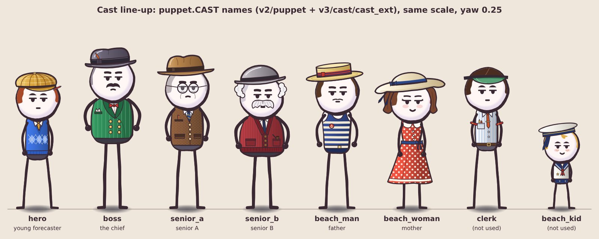
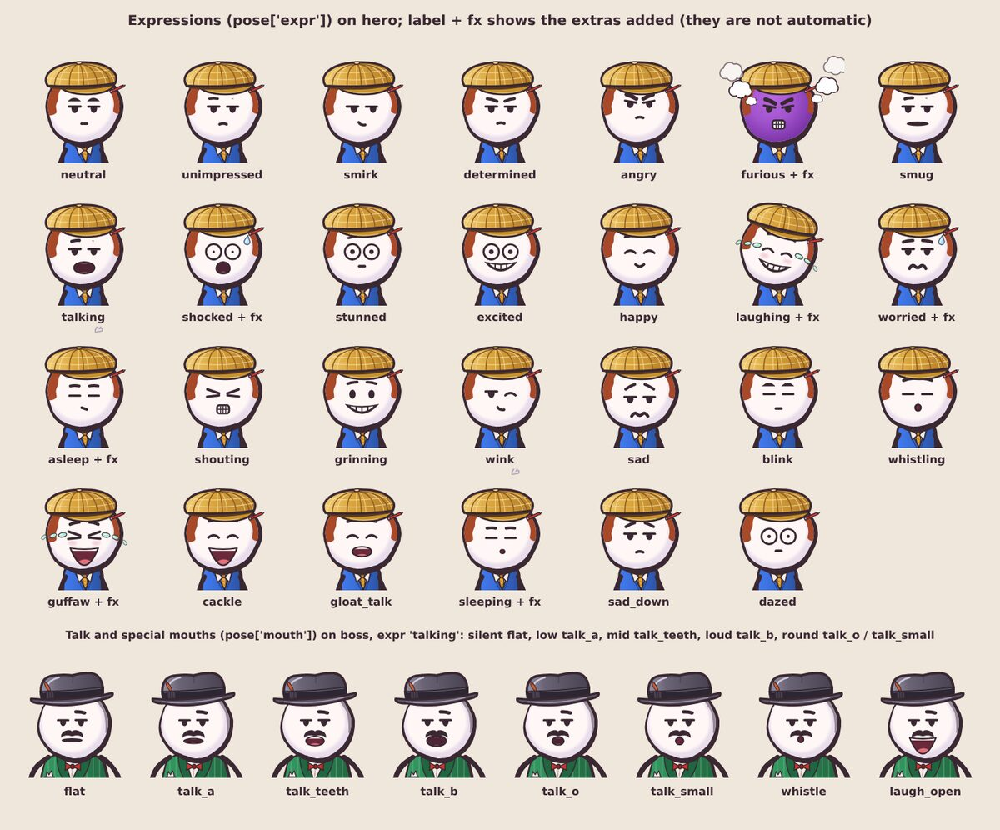
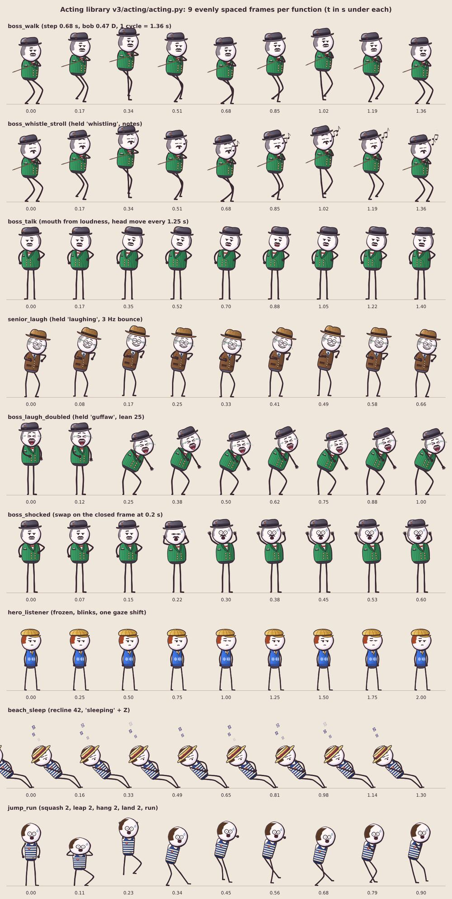

# Characters and acting

Units: **D** = outer head diameter, ink to ink (also 1 Blender unit on the stage). Pixels are at 720x1280. Times in seconds and frames at 30 fps. Code paths are relative to the skill's `pipeline/` folder; project sources in the Sources list are relative to `__PROJ__`.

## The rules in brief

1. Characters are flat, unlit 2D ink-and-fill puppets (SVG), shown on emission-only cards standing in a lit 3D set. Never shade or light a character; it only casts a shadow.
2. Head = full circle, white `#fef7f6` with one lavender crescent `#e9dceb`; plum ink `#3a2832`, thin on the side the key light comes from and thick away from it. No neck, nose, ears or lashes (one exception: `beach_woman` has lashes).
3. Body about 3 D tall (2.3 to 3.4); one rounded torso shape carries the costume; limbs are constant-width ink strokes with ball hands; hats replace the top 20 to 30 % of the head.
4. Faces never tween. They swap whole drawings, and every expression change sits on the closed frame of a 3-frame blink (half, closed, half).
5. Only the character the narrator is quoting moves his mouth: a new drawing every 2 to 6 frames, driven by narration loudness, not phonemes. The listener freezes (under 0.04 D), blinks only.
6. Speaker: one head move every 1.0 to 1.5 s (0.15 to 0.30 D, roll 10 to 20 deg, eased over 8 to 12 frames). One gesture per shot, eased over 8 to 10 frames, on the caption word.
7. Nobody ever shows his back: front, three-quarter or near-profile only. Turning = features slide up to 0.14 D, the head disc never changes.
8. Head sizes: close 300 to 350 px (extreme close 390 to 440), medium 170 to 230, wide 110 to 135. Whole heads above y 880 (caption band 880 to 950), main head centre 0.35 to 0.59 H.
9. Two-shot in depth: near listener bigger and lower, far speaker smaller and higher, head ratio 1.36 to 1.46.
10. Props held in a hand that touch the set are pinned to their world target by the registration helper (error 0 px while pinned).

Sheets: `../../assets/bible/characters_cast_lineup.jpg` (all 8 puppets by code name), `../../assets/bible/characters_expressions.jpg` (all 27 expression drawings plus the 8 talk/special mouths), `../../assets/bible/characters_acting_cycles.jpg` (9 acting functions, 9 frames each). All three were rendered for this chapter from the bundled code (`pipeline/v2/puppet`, `v3/cast`, `v3/acting`), not from the reference.

---

## 1. Reference (measured)

Two reference clips: A (3D world, 16 shots) and B (painted plates, 22 shots; shot counts from `spec/camera_motion.md`, as in camera.md). Both are conventionally made animation, not AI video (forensics, 88 % confidence).

### 1.1 Design as numbers (D = 1, origin head centre, y down)

| Part | Measured value |
|---|---|
| Head | circle in clip A (within 2 %); clip B ovals W/H 1.06 to 1.12 (not used by us). Fill radius 0.463 D |
| Head fill | flat `#fef7f6` (identical in 5 clip A frames); lavender crescent `#e9dceb` on the lower-right rim: 0.09 D wide at 50 deg, 0.07 at 0 and 90 deg, 0.045 at 135 deg, gone by 180 deg, feathered over 0.04 D. No highlight, no terminator, no specular |
| Ink | dark plum: `#382731`, `#3a2932`, `#382630` (A t44.0), `#3c2129` (B t21.0); built as `#3a2832`. Night in B: `#1b1534` / `#1e142e` |
| Head outline | thick-thin: left 1.5 to 2.8 % D (median 2.0), right 4.4 to 6.7 % (median 5.0), lower right 5.4 to 7.8 % (median 6.6). Wobble 1.0 to 1.5 % D rms. Does not boil between frames (profile correlation 0.99 to 1.00 over 16 frames) |
| Neck | none; head overlaps the torso by 0.10 to 0.15 D |
| Torso | one closed rounded shape. Slim pill 0.57 x 0.99 (hero), regular egg 0.78 x 1.04, stout egg 1.00 x 1.06 (boss, widest low). Trouser bowl = bottom 0.14 D, dark. Contour 0.03 D. Airbrush gradient left to right: base x1.12, base, base x0.72 (e.g. `#ddba4f` / `#c79d2d` / `#936e1e`) |
| Limbs | single ink strokes, round caps, arms = legs width 0.055 to 0.075 D (boss 0.07 to 0.08, hero close 0.04 to 0.046). Arm 0.71 to 0.79 D, elbow mid. Leg 1.07 to 1.52 D; knees only when walking, sitting, crouching |
| Hands, feet | ink ball 0.13 to 0.14 D; fingers only for a gesture (1 stroke pointing, 3 to 4 open). Feet: stub about 0.2 D (A) or a bar 0.24 D (B) |
| Height | head top to feet 2.9 to 3.4 D (hero 2.93, boss 3.39, inventor 3.07) |
| Inner detail lines | 0.012 to 0.022 D (V-neck, pockets, button rings, stitching) |
| Hats | drawn over the head, lower edge at y -0.21 to -0.29; brows sit under the brim. Bowler dome rx 0.42 ry 0.31, brim 1.12 D; striped cap 0.85 to 0.95 D wide; top hat 0.84 x 0.57 crown, brim 1.14; crown, helmet, peaked cap. Hats carry 2 to 3 flat tones and one painted streak |
| Hair | flat patch inside the head outline under the hat, ragged inner edge, no ink line; grows into the back of the head when turned |
| Costume logic | 5 to 7 readable elements per lead (neck shape, button row, straps or chain, 1 to 3 pockets, trouser bowl, hat, hair); one hue per lead, absent from the walls behind; extras in muted navy `#2f4171`, purple `#885285` |
| Distinct characters | A: hero, boss, tycoon, foreman, newspaper kid, workers. B: inventor, emperor, guard, court official. They differ by silhouette (torso type, height, hat crown) first, main hue second, face extras (moustache, beard) third |

### 1.2 Faces and expressions

Feature placement: eye spacing 0.26 D, eye line y +0.03, mouth 0.18 D below the eye line, brows 0.13 D above the eyes.

| Element | Measured |
|---|---|
| Default eye | half-lid: lid bar 0.178 x 0.030 with a U pupil 0.086 wide hanging under it; neutral, smug, angry, worried and sad all use it |
| Other eyes | ring 0.21 to 0.225 D (pupil 0.06 excited, 0.033 frightened); happy arc 0.16 x 0.06; closed line; dot (rare); squeezed `> <` |
| Brows | separate floating strokes 0.16 to 0.22 long, 0.025 to 0.057 thick; often only ONE (over the near eye) |
| Mouths | dash, arch frown, smirk, small smile, grin 0.42 x 0.13 with 4 teeth, flat bar, talking ellipses (interior `#4d2433`), "O", clenched 4x2 teeth, wavy, moustache-lip |
| Effects | sweat drop (`#b6e3ff`, slate outline `#5c647a`), purple anger fill rising in 8 frames plus steam, laugh tears and blush, three sleep Z, hair on end, focus lines, stubble. Never seen: speech bubbles, impact stars, vein marks, ? or ! marks |
| Turn | features slide toward the facing side: 0.03 slight, 0.06 medium, 0.08 to 0.14 strong; spacing shrinks to 0.17 to 0.205; far eye 0.85 to 0.89 of the near |
| Head roll in acting | -19 to +30 deg; an upright head is the exception in dialogue |

Expression change: a swap of the whole face drawing, completed within 1 to 2 frames, 1.3 to 3.5 swaps per second during a reaction, always behind closed eyes (seen 7 times). Never a tween.

Blink: open, half (1 frame), closed (1 to 2 frames), half (1 frame), open: 4 to 5 frames. Rate: clip A 4 blinks in 2.83 s on a listener and 3 in 1.70 s on a wide-eyed hero (spacing 0.60 and 0.73 s in a close-up); clip B 1 in 2.4 s plus a held wink (13 frames). A speaker may go 1.8 s without a blink.

Mouth while speaking: a new drawing every 1 to 3 frames by the face lens, about 7 per second by eye (12 states in f1381 to f1429), 4.9 to 9.8 per second by ink area; biggest shape held up to 4 frames. Correlation with narration loudness 0.57, 0.36, about 0: loudness-driven flapping, **not phoneme lip sync**. Eyes and brows hold still meanwhile. A listener's mouth never moves.

### 1.3 Movement

| Measured | Value |
|---|---|
| Frame rate | on ones at 30 fps; no held frames (0 of 60 frame pairs are holds in a locked-camera walk) |
| Bodies vs faces | bodies move by smooth eased interpolation; faces swap |
| Talking boss (two-shot) | pops up, then small nods; head travel y 0.34 D, x 0.12 D |
| Speaking heads, clip B | sway 0.28 D sideways, 0.14 to 0.15 D vertical per shot |
| Listener | 0.03 to 0.04 D travel, slower than 0.05 D/s for 40 % of frames; frozen except blinks |
| Walk cycle (B f1316-1376, locked camera) | **it exists**: near-profile, head bob 0.47 D peak to peak, period 0.68 s (20 frames), sideways sway 0.13 D, legs scissored |
| Entrance | pop up or slide in from the edge over 4 to 6 frames, then small nods (boss A f1346-1366) |
| Jump scare | squash blink 2 frames, leap 2, hang 2, land 2; body rises about 1 D; hair on end held 10 frames |
| Laugh | head thrown back or tilted, body curved, held laughing drawing (B t06.0 to t07.0) |
| Motion blur | never on characters, even at 250 px per frame |

Poses seen: arms akimbo, one hand on hip, arms hanging, leaning in 35 to 45 deg, shouting arched back, striding in profile, arm extended (offering, pointing), arm raised to the hat, sitting with legs dangling, sitting cross-legged with a cup, crouching in a Z, holding a large prop with both hands, laughing, body tilted 25 deg.

### 1.4 Size in frame, facing, light

| Shot | Head D on screen |
|---|---|
| Extreme close | 390 to 440 px (B t33.5: 389) |
| Close | 300 to 350 px (A t55.0: 349; up to 394 in B) |
| Medium | 170 to 230 px (A t02.0: 190, A t16.0: 191) |
| Wide | 110 to 135 px |
| Establishing / background figures | 30 to 75 px (single background figures down to 20 px) |

These are the camera.md 1.3 bands (outer D). The face-lens spec gave wider raw spans (medium 170-250, wide 100-180 px) that include in-between framings; plan with the bands above.

- Facing: five yaw states (front, three-quarter left/right, near-profile left/right). **No back view was found.** Both eyes stay visible even in near-profile. Figures stay frontal drawings parallel to the screen; they do not foreshorten under low or high cameras (depth only by scale and overlap).
- Light: characters are **not lit** by the scene in clip A (head fill luma spread 23 to 24 levels). The crescent ignores the sun direction. Clip B multiplies the whole figure by one colour per shot: warm interior (0.99, 0.91, 0.84), night with lamp (0.99, 0.81, 0.88), night without lamp (0.71, 0.71, 0.94).
- Sharp picture: no depth-of-field blur (client decision). Depth comes from real 3D parallax, cast shadows, overlap and light.

---

## 2. Our build (film 1)

### 2.1 The puppet system

| Layer | Module | What it does |
|---|---|---|
| Drawing | `v2/puppet/puppet.py` | `figure(cast, pose, uid)` -> SVG in D units, head centre at (0, 0), y down. Standard library only, deterministic, about 1 ms per call |
| Extra cast | `v3/cast/cast_ext.py` | adds 6 members, hat styles, costumes, props; registers on import |
| Acting | `v3/acting/acting.py` | pure functions `f(t, ...) -> pose dict`; new mouths, expressions, props; narration loudness; imports cast_ext |
| Sprites | `v3/stage/sprites.py` + `sprite_page.js` | pose -> transparent RGBA PNG through one persistent Chromium page (31 ms per 928x1136 sprite) |
| Cards | `v3/stage/actors.py` | `Actor`: card, shadow proxy, contact decal, placement, pinned hands |

Import order that works (tested from the skill's `pipeline/` folder):

```python
import sys
sys.path.insert(0, "v3/acting"); import acting as A        # also imports cast_ext and puppet (8 cast members)
import puppet as P
sys.path.insert(0, "v3/stage"); import actors, camrig, render, sprites, stubroom   # needs bpy 5.3
```

**How a character is described**: one dict in `puppet.CAST[name]` with keys `build` (`slim`, `stout`, `regular`, `child`), `seed` (head wobble, fixed per character), `torso_w`, `torso_h`, `profile`, `shoulder`, `arm` (0.74), `hip_x`, `leg`, `stance`, `wide`, `limb_w`, `eye_y`, `brow` (`dome`/`stroke`), `brow_th`, `mouth` (default mouth), `moustache`, `smirk_side`, `hat` (`newsboy`, `homburg`, None; cast_ext members put `newsboy` here and choose with `hat_style`), `hat_tilt`, `hat_colors`, `hair` (`color`, `front`, `grow`, optional `style`), `costume`, `colors`, plus cast_ext extras (`glasses`, `moustache_style`, `pencil_moustache`, `lashes`, `cheeks`, `freckles`, `garters`, `age_lines`, `scale_hint`).

**Parts and draw order** (back to front): far arm, legs and feet, torso ink, torso fill and costume, near arm and hands, head ink, head fill, crescent, hair patch, face features, blush, sweat and tears, hat, held props, steam and Z.

**Fixed constants** (`puppet.py`): `INK = #3a2832`, `HEAD_FILL = #fef7f6`, `HEAD_SHADE = #e9dceb`, mouth interior / tongue / teeth `#4d2433` / `#7b626c` / `#fef9f8`, sweat `#b6e3ff` / `#def9ff` / `#5c647a`, blush `#f8d7e1`. The acting module's new mouths use cavity `#6b2a3c`, tongue `#e0707a`, teeth `#fffaf4`. Head ink widths (re-calibrated per angle): 0.052 right, 0.071 lower right, 0.050 at 120 deg, 0.036 at 150, 0.027 left. Wobble is baked into the paths (no SVG filters: filter noise swims under camera moves).

**Pose keys** (all optional; full table in `v2/puppet/API.md` section 3):

| Key | Range | Effect |
|---|---|---|
| `yaw` | -1.2..1.2 | yaw > 0 faces screen-right, < 0 screen-left; `flip` (the second value `place(g)` returns) mirrors the whole sprite. 0 front, ±0.5 three-quarter, ±1 near-profile. Face slides 0.12 x yaw, spacing 0.26 - 0.075\|yaw\|, far eye 1 - 0.14\|yaw\|, torso 1 - 0.15\|yaw\| |
| `pitch` | -1.5..1.5 | features move 0.07 D per unit; -0.9 proud/low angle, +1 looking down |
| `head_roll` | deg -75..75 | rolls face, hair, hat; the disc and crescent stay put |
| `head_dx`, `head_dy` | -0.8..0.8 | head offset from the torso axis |
| `lean` | deg | torso lean about the head centre |
| `squash` | 0.3..2.5 or (sx, sy) | squash and stretch about the head centre |
| `expr` | 27 names (2.3) | face drawing, discrete |
| `mouth` | MOUTHS name or ("open", w, h) | overrides the mouth (talk) |
| `blink` | 0, 1, 2 | open, half, closed |
| `gaze` | -1..1 or (gx, gy) | pupil shift 0.03 D per unit |
| `arm_r`, `arm_l` | preset or dict | presets: `down hip akimbo point raised behind forward reach_up rub shrug chin wave shade`; dict keys `hand` (IK target), `preset`, `bend`, `sharp`, `stretch`, `layer` (`front`/`back`/`top`), `shape` (`ball`/`point`/`open`) |
| `legs` | preset or dict | `stand wide narrow step lean crouch`; dict `spread stride crouch lift_r lift_l foot_r foot_l knee_r knee_l toe_r toe_l rigid` |
| `prop_r`, `prop_l` | type or dict | 12 types (2.4) with `angle`, `twist`, `scale` |
| `fx` | list | `sweat anger_fill steam blush focus_lines tears zzz` |
| `t` | 0..1 | phase of looping fx |
| `tint`, `ink` | hex | multiply fills (ink untouched) / ink colour (night `#1e142e`) |
| `limb_w` | 0.035..0.09 | limb stroke; use about 0.8 x default in a close-up |
| `rim` | hex | light halo behind limbs on dark backgrounds |
| `mirror` | bool | mirror everything except the head disc |
| `hat_dx`, `hat_dy`, `hat_rot`, `hat_off` | (acting) | hat over the eyes, lifting in a gust, popped off |

`figure()` returns `svg`, `feet_y`, `bbox`, `anchors` (`hand_r/l`, `prop_tip_r/l`, `shoulder_*`, `elbow_*`, `head_top`, `hat_top`, `head`, `mouth`, `eye_*`, `chest`, `hip`, `knee_*`, `foot_*`, `feet`).

**Sprite and card** (`v3/stage`):

| Item | Value |
|---|---|
| Card | `<name>_card`: a vertical quad the size of the canvas, origin at the feet point, yaws with the camera (never pitches, never mirrored). Emission-only image material: unlit, untinted; measured on screen exactly `#fef7f6` / `#3a2832` |
| Canvas (card size) | feet-relative `(x0, y0, x1, y1)` in D, snapped to 1/16 D. `sprites.DEFAULT_CANVAS` holds only hero and boss; the other rows are `cast_ext.CANVAS` and reach DEFAULT_CANVAS only when `cast_ext` is imported (the otake runners do not import it: pass `canvas=` in `ACTORS`). Values: hero (-1.8125, -4.3125, 1.8125, 0.125) = 928x1136 px at 256 px/D; boss (-1.9375, -4.75, 1.9375, 0.125) = 992x1248; senior_a (-1.875, -4.625, 1.875, 0.125); senior_b (-1.9375, -4.375, 1.9375, 0.125); clerk (-1.8125, -4.5625, 1.8125, 0.125); beach_man (-1.8125, -4.5, 1.8125, 0.125); beach_woman (-1.8125, -4.3125, 1.8125, 0.125); beach_kid (-1.4375, -3.625, 1.4375, 0.125). Wider poses (sideways pointer 2.4 D, lean past 20 deg): `sprites.canvas_for(cast, poses)` |
| Anchor | the feet point (`anchors["feet"]`, `feet_y`): the soles land on the floor for every camera (gap 0.0 to +1.3 px measured) |
| `px_per_D` | 1.3 to 2 x the largest on-screen head: 256 for wide and medium, 320 to 512 close (film: 288 to 480; hand cards 512 to 800). Keep under about 2.5 x on-screen head or thin lines shimmer |
| `upper_k` | the drawing above the hip is stretched so the head stays round under low (1.02 to 1.09) and high (1.07 to 1.15) cameras; automatic in `Actor.pose` |
| Shadow proxy | `<name>_shadow`, seen only by shadow rays; turned toward the key light (at most 40 deg off its normal) above 0.9 x hip height, lying in the card below 0.12 D so the shadow starts at the drawn feet (0.0 px). `build(shadow="proxy")` default; `"card"` or `None` possible |
| Contact shadow | `build(contact=True)` or `contact=dict(width=0.9, depth=0.42, color="#252432", opacity=0.5)`: soft multiply ellipse 0.004 D above the floor. Standing actors in the film had it (the reclining sleeper of s08 and the hand cards did not). 2D variant `puppet.contact_shadow(0.9)` (`#252432`, opacity 0.6) |
| Thick ink side | puppet default: crescent and thick ink at the lower right (key from screen-left). Key from screen-right: `actor.head_flip = True`. The office takes set it True throughout; the beach runner sets it per frame: `head_flip = (-key_dir) . camera_right > 0` |
| Tint | storm close-up shot 24: `pose["tint"] = "#b5b5f0"` (= 0.71, 0.71, 0.94) |

### 2.2 The cast (8 puppets; 6 were used)



| Name in code | Role in film 1 | Build, height (head top to soles), limb_w | Head and face | Hat (hex) | Costume parts (hex) | Distinguishing marks |
|---|---|---|---|---|---|---|
| `hero` | young forecaster; never speaks | slim pill 0.57 x 1.01, legs 1.10, 2.99 D (+0.07 cap), 0.054 | dome brows, dash mouth, auburn hair `#a8492a` | ochre tweed 8-panel newsboy cap: base `#dca63e`, light `#f1cf7c`, dark `#b27a26`, visor `#c8932f`, band `#5a3a22`, check `#f7e3a6`, seams `#8a5a22` | cobalt sweater vest `#3b6fda` (dark `#234a9c`, rib `#2f5cc0`) with argyle row `#8fb2f6`, stitch `#f6ead0`; cream shirt collar `#f4ede7`; ochre tie `#e3a93a` / `#b47a22`; trousers `#4c4453` | red map pencil `#d5392f` behind the screen-right ear; shortest adult |
| `boss` | the chief; speaks the two quotes | stout egg 1.00 x 1.06, legs 1.45, 3.40 D (+0.21 hat), 0.068 | heavy stroke brows, arch frown, ink moustache, grey hair `#988c98` | grey felt homburg: base `#6b6476`, light `#9c96aa`, dark `#474151`, shine `#dedaea`, band `#2c2732`, bow `#474150`, brim `#5d5667`, edge `#b3adbf`; orange feather `#e2703a` / `#a84420` | forest-green double-breasted waistcoat `#2f8b58` (dark `#1e5f3b`, lapel `#1f6641`) with chalk pinstripes `#8fd3a8`; white shirt V `#f1eae5`; red bow tie `#c9352e` / `#98241f`; six brass buttons `#e0c063` / `#f1e2a4`; white pocket square; trousers `#3d3846` | tallest; moustache pushes the mouth down 0.058 D |
| `senior_a` | older forecaster (left of the trio) | regular egg 0.78 x 1.04, legs 1.30, 3.21 D, 0.062 | round wire spectacles, heavy brows, frown, age lines, silver hair `#bdb5b8` | camel pinched fedora: base `#b8854c`, light `#dcb27a`, dark `#7c5530`, shine `#f1dcb2`, band `#3b2a22` / `#5a4030`, brim `#a77543`, edge `#dcb985` | brown herringbone tweed waistcoat `#7b4f33` (dark `#4b2f1f`, fleck `#b98d62`); pale-blue shirt `#d7e3f1`, collar `#eef3f8`; navy tie `#2f4f8a` / `#1f3563` with mustard bars `#e2b44a`; 4 horn buttons `#e0bd84`; pocket `#6a432b` with red fountain pen `#9e2b25`; grey trousers `#575264` | glasses; mid height |
| `senior_b` | older forecaster (right) | stout pear 1.06 x 0.98, legs 1.16, 3.01 D, 0.068 | white walrus moustache `#efebef`, white tufts, age lines, hair `#d4ccd6` | pale dove-grey bowler: base `#aca6ad`, light `#d6d1d6`, dark `#6f6973`, shine `#f6f3f7`, band `#2f2a33`, brim `#958f97`, edge `#dcd7dd` | burgundy rib-knit cardigan `#a8383f` (dark `#5c1820`, rib `#7c2630`, band `#76222b`), shawl collar, 3 leather buttons `#7a4a2a`, 2 patch pockets `#862a32` (briar pipe `#6b3d26` in one), white shirt `#f0ebe6`, navy knit tie `#283a62`; trousers `#3d3a46` | short and round |
| `beach_man` | the father on the beach | regular athletic 0.70 x 1.00, legs 1.24, 3.10 D, 0.058 | pencil moustache, hair `#5a3826` | straw boater: base `#ead17e`, light `#f7e8b4`, dark `#b8954a`, brim `#ecd58a`, weave `#b8984e`, red band `#c7362c` with navy stripes `#22336a` | 1930s one-piece bathing suit navy `#354b8e` with cream hoops `#f1e8d4`, red anchor badge `#c7362c`, white belt `#f4ecdb`, brass buckle `#d9b95c`, navy trunks `#1f2c57`; bare arms = head white | boater pops off in shot 24 |
| `beach_woman` | the mother | slim hourglass 0.52 x 0.90, legs 1.16, 2.92 D, 0.055 | lashes, pink cheeks `#f4b9b6`, smile, chestnut bob `#7a4630` outside the head contour | wide cream sun hat 1.56 D: base `#f2e6c8`, light `#fffaee`, dark `#c9b48a`, navy ribbon `#2c4a8a` / `#1d3263` with bow and tails | coral polka-dot dress `#d84a3a` (dark `#9c2c22`, dots `#fbf2e6`), Peter Pan collar `#fcf7ef`, 3 white buttons, navy sash `#2c4a8a` with side bow, A-line skirt with white hem trim | only far or profile in film 1 |
| `clerk` | not used | slim 0.55 x 1.00, legs 1.30, 3.16 D, 0.055 | slicked hair `#4b2c20` with parting | green eyeshade: band `#2f2a36`, visor `#2f8a58` / `#9fe0b8` | blue-pinstriped shirt `#e6ebf1` (stripe `#7a9bd0`), orange tie `#d65a2c`, two pencils, brown belt `#5b3a26`, grey trousers `#5e5868` | red sleeve garters `#c0332a` |
| `beach_kid` | not used | child pill 0.50 x 0.72, legs 0.70, arm 0.54; draw at `scale_hint` 0.8 = 1.82 D | freckles, cheeks `#f6c3c0`, blond curl `#e0ad4a` | sailor cap: white `#f3f1ea`, band `#24366b`, gold `#e3c04f` | white middy blouse `#f3f0e8`, navy collar `#24366b`, red neckerchief `#d23b2e`, gold star `#e8c04a`, navy shorts | 0.59 of the father's height |

All share the same head (D = 1), ink, ball hands and rubber-hose limbs. The leads differ by silhouette (short slim with flat cap / tall stout with brimmed hat), by hue (ochre + cobalt / grey + green + red) and read apart at a 110 px head.

### 2.3 Expressions and mouths available



| `expr` | Eyes / brows / mouth | Add yourself |
|---|---|---|
| `neutral` | half-lid / two (hero domes, boss strokes) / hero dash, boss arch frown | |
| `unimpressed` | half-lid / one flat over the near eye / arch frown | |
| `smirk` | half-lid, gaze +0.02 / none / smirk | |
| `determined` | half-lid / both +15 deg / arch frown | |
| `angry` | half-lid tilted 10 deg / heavy +24 deg touching lids / arch frown | `pitch=-0.9` |
| `furious` | as angry / clenched teeth | `fx=["anger_fill","steam"]` |
| `smug` | half-lid / one raised -7 deg / flat bar | |
| `talking` | half-lid / one raised / wide talk mouth | cycle `mouth` |
| `shocked` | ring, 0.033 pupils / none / "O" | `fx=["sweat"]` |
| `stunned` | ring, 0.06 pupils / one short raised / dash | |
| `excited` | ring 0.06 / none / grin with 4 teeth | |
| `happy` | happy arcs / both raised 0.20 / small smile | |
| `laughing` | happy arcs / raised / wide grin | `fx=["blush","tears"]`, `head_roll=15` |
| `worried` | half-lid / both -9 deg / wavy | `fx=["sweat"]` |
| `asleep` | closed lines / flat, low / tilted dash | `fx=["zzz"]` |
| `shouting` | squeezed `> <` / none / clenched teeth | |
| `grinning` | dot eyes / thin raised / grin | |
| `wink` | far eye arc, near half-lid / one high / smirk | |
| `sad` | half-lid / both -28 deg / wavy | `pitch=1` |
| `blink` | closed lines / neutral | same as `blink=2` |
| `whistling` (acting) | closed / both raised / whistle pucker | held, never flapped |
| `guffaw` (acting) | squeezed / raised / `laugh_open` | tears, blush |
| `cackle` (acting) | happy arcs / raised / `laugh_open` | |
| `gloat_talk` (acting) | happy arcs / raised / `talk_teeth` (talk overrides) | |
| `sleeping` (acting) | closed, lower / flat / tiny o | `fx=["zzz"]` |
| `sad_down` (acting) | half-lid / steep sad -24 deg / frown | `pitch=1` |
| `dazed` (acting) | small-pupil rings / none / dash | |

Mouths (`pose["mouth"]`): `default none dash frown smirk smile grin flat talk_a talk_b talk_o o clench wavy` plus acting's `whistle laugh_open talk_teeth talk_small` (and `o_small_sleep`, used by `sleeping`). Talk set: silent `flat`, low `talk_a` (0.28 x 0.085), mid `talk_teeth`, loud `talk_b` (0.285 x 0.17), round `talk_o` (0.18 x 0.13) / `talk_small`.

Body poses: arm presets and leg presets of 2.1; story poses in `P.STORY`: `hero_draw`, `boss_rub`, `hero_shock`, `seniors_agree`, `walrus_scoffs`, `clerk_runs_in`, `father_looks`, `kid_bucket`.

### 2.4 Props held in the hand

`P.PROP_TIP` gives the working point distance from the hand (D): `pencil` 0.36, `eraser` 0 (felt face under the hand), `pointer` 1.17, `paper` 0.58, `bucket` 0.47 (hangs upright), `newspaper` 0.44, `forecast` 0.52, `mug` 0 (upright), `ruler` 0.84, `tape` 0.50, `stamp` 0.21, `stub` 0.20 (worn pencil). Worn eraser = `{"type": "eraser", "scale": 0.6}`. `anchors["prop_tip_r"]` is the tip actually drawn.

### 2.5 The acting library (`v3/acting/acting.py`)



Conventions: `t` = seconds from the first frame of THAT action. Faces change on whole frames (`fr(t) = round(t*30)`), bodies are continuous. Extra keys (strip them before `figure()`; `Actor.pose` ignores them): `_lift` (D, raise the card root), `_adv` (D travelled along the facing direction: key `actor.place(start + facing_dir * _adv + up * _lift)` every frame so the planted foot stays put; measured slide 0.04 D per frame), `_notes` (whistle glyphs), `_tip`, `_tip_angle`, `_seat`. The library's continuity check found 0 unintended pops in its 41 sequences.

Helpers:

| Helper | What |
|---|---|
| `fr(t)` | frame index of t |
| `blinks(t, starts)` | 0/1/2 for blinks starting at the times given: half, closed, half. The closed frame is one frame after the start |
| `closed_at(t, at)` | True from `fr(at)`: put the swap there |
| `go(u)` | gesture ease with about 4 % anticipation and overshoot, use over 9 to 10 frames |
| `arm_blend(cast, a, b, u)` | continuous move between two arm specs |
| `loudness(t0, t1, path)` | 33 ms RMS per frame / running 1 s median of voiced frames; 0 = silence (under 4 % of peak). Frame k = narration time t0 + k/30 = film frame round((t0 + 0.1) x 30) + k. Default path is film 1's narration (`audio/th/full_v2/narration.wav`, not bundled): pass `path=` |
| `talk_mouth(loud)` | one mouth per frame: < 0.35 `flat`, < 0.8 `talk_a`, < 1.25 `talk_teeth`, else `talk_b` (held up to 4 frames); every fourth open change round; holds 3 to 6 frames. Measured on the two quotes: 8.2 and 8.6 changes per second |
| `speaker_motion(t, accents)` | head target at each accent (default every 1.25 s): roll ±10 to 15 deg, 0.14 to 0.22 D sideways, eased over 10 frames, torso at about a third |
| `note_glyphs_svg(notes, origin=(0.25, -0.1), facing=1, ink="#3a2832", fill="#3a2832")` | **film 1 only, off-style** (the reference never draws note glyphs; scene-tricks 6 lists film 1's s17 glyphs as a fault): rising quavers from `origin` (the mouth point, D), 1.1 s life (canvas needs +1.0 D above, +0.7 D ahead) |
| `flying_hat_svg(cast, yaw)` | the hat alone, for a flying-hat card |
| `hand_canvas(cast, pose, side)` | tight canvas around elbow, hand and prop for hi-res hand sprites |

Functions (all return a pose dict; "any cast" = pass `cast=`):

| Function (key arguments, defaults) | Period / timing | Shows | Film 1 shot |
|---|---|---|---|
| `boss_talk(t, loud, base=None, accents=None, expr="talking")` | mouth every 2 to 6 frames; head move every 1.25 s | quoted line: eyes held, no blinks, mouth from loudness; `smirk` after the line; base pose's roll/dx/dy/lean added | 10, 18 |
| `boss_walk(t, speed=0.75, facing=1, step=0.68, bob=0.47, sway=0.13, yaw=0.95, arms="behind", pointer=True, expr="smug", blinks_at=(), cast="boss")` | step 0.68 s (cycle 1.36 s) | near-profile walk, bob 60 % knees + 40 % `_lift`, feet planted with `_adv`; arms `behind` or `swing`; any cast | 17 |
| `boss_whistle_stroll(t, notes_at=(0.3,0.6,0.9), speed, facing)` | as walk; pass `notes_at=()` (film 1's default times feed off-style note glyphs) | walk + HELD `whistling`, chin up, `_notes` | 17 |
| `boss_laugh_doubled(t, t_in=0, ramp=0.33, lean=25, facing=-1, bounce_hz=4.5, slap_at=(0.5,), pull_strip_at=None)` | shake 4.5 Hz | held `guffaw`, bowed 25 deg, tears, blush, hand on belly, thigh slaps | 12 |
| `boss_shocked(t, t_shock=0.2, before="smug", yaw=-0.45, drop_pointer_at=None, base=None, cast="boss")` | swap on the closed frame at t_shock; squash 0.03 D for 2 frames; arms flinch over 6 frames | ring eyes, O, sweat, head pops back 0.08 D, open hands; any cast | 25 |
| `boss_finger_wag(t, t0, dur=0.4, yaw, wags=3)` | 3 wags in 0.4 s | base for `boss_talk` | 10 |
| `boss_lean_wink(t, t0, wink_at, wink_len=0.15, yaw, horn=False)` | wink 0.15 s held | lean 0.12 D + 9 deg, laughing eyes, held wink; `horn` squeezes a horn | 10, 18 |
| `boss_mock_search(t, t0, yaw)` | | hand shading the eyes, turning | 18 |
| `boss_pointer_whack(t, t_land=0.5, yaw=0.4, raise_len=0.3, target=(1.05,-0.35))` | 3-frame whack | raise, whack, contact squash, rebound | 6, 18 |
| `boss_thumb_jerk(t, t0, yaw, expr, cast)` | held 0.8 s | thumb back over the shoulder; any cast | 9, 12 |
| `boss_eraser_bounce(t, yaw, hz=1.6)` | 1.6 Hz | eraser tossed in the palm, smirk | 10 |
| `boss_rub_furious(t, t0, stroke=0.33, fill_len=0.8, yaw)` | stroke 0.33 s; purple fills over 0.8 s | big strokes, anger_fill, steam (pin the eraser) | 11 |
| `boss_frozen_purple(t, twitch_every=0.4, yaw)` | twitch every 0.4 s | frozen purple, eye twitch | 11 |
| `boss_pant(t, pants_at=(0.1,0.55), yaw, nub=True)` | | two pants, worn eraser nub | 11 |
| `boss_stamp_thrust(t, stamp_at, tear_at, thrust_at, yaw)` | | stamp down, tear, thrust sheet at the lens, nod | 14 |
| `boss_read_tape(t, tear_at=0.4, yaw)` | | reads a tape, tears it | 4 |
| `hero_slumped(t, yaw=0.5, blinks_at=(0.83,), turn_hz=0.8)` | pencil turns 0.8 Hz | lean 4 deg, head down, `sad_down`, breathing 0.01 D | 17 |
| `hero_sad_listener(t, yaw, blinks_at, shut=(1.48,0.13), sweat_at)` | eyes shut 4 frames | frozen sad listener, sweat | 18 |
| `hero_listener(t, yaw, expr="unimpressed", blinks_at=(0.33,0.93,1.73), gaze_shift=(1.53, before, after))` | | frozen, blinks, one sideways gaze shift | 10, 11 |
| `hero_stunned(t, t_swap=0.1, close_at=0.6, from_expr, yaw)` | | stunned behind a blink, then eyes shut and head lowered 0.1 D | 25 |
| `hero_redraw(t, t0, swipe=8, yaw, start, end, ruler=False, stub=False)` | 8-frame sine swipe | pencil tip from start to end with overshoot; `_tip`, `_tip_angle` for pinning | 9, 11 |
| `hero_ruler_rest(t, yaw, blinks_at)` / `hero_study(t, yaw=-0.5, blinks_at)` | | ruler shouldered / chin in hand | 11 / 4 |
| `senior_nod(t, nods_at, cast, yaw, expr="unimpressed", depth=0.6, blinks_at)` | nod down in 4 frames, back in 6 | pitch 0.6 + 0.05 D dip; any cast | 6 |
| `senior_laugh(t, cast, yaw, phase=0, hz=3, bounce=0.06, roll=15, thumb_at=None, expr="laughing")` | 3 Hz | held laughing, head rolled 15, bounce 0.06 D, lean 9 to 13 deg; give two laughers phase 0 and 0.5; any cast | 12 |
| `beach_sleep(t, breath=1.3, facing=1, recline=42, z=True)` | breath 1.3 s | reclined 42 deg, legs out, boater over eyes, `sleeping` + Z; card root = heels, `_seat` = hip point the seat must carry | 8 |
| `beach_stretch(t, t0, facing)` / `beach_palm_out(t, t0, drops_at, facing, cast)` / `beach_shrug(t, t0, facing, cast, expr, hold=0.5)` | 1-frame dips per drop | arms up and out; palm out; shrug | 16 |
| `beach_shade(t, t0, facing=-1, cast, stunned_at=None)` / `beach_hold_hat(t, cast, facing, gust_at=None)` | | shading the eyes toward the sea; hand on the brim, gust lifts it | 23 |
| `beach_shocked(t, t_shock, cast, facing, hat_pop=True, focus=True)` | 3 frames of focus lines; boater lifts 0.45 D and spins over 3 frames then `hat_off` | shocked swap + squash | 24 |
| `jump_run(t, t_jump, cast, facing, height=0.55, run_speed=3.2, hat_off=None)` | squash 2, leap 2, hang 2 (`_lift` 0.55 D), land 2, then run | jump scare then run (`beach_man` is drawn hatless by default) | 24 |
| `run_cycle(t, cast, facing, speed=3.2, step=0.34)` | step 0.34 s | walk at double rate, lean 14 deg, arms pumping, flight `_lift` up to 0.10 D, sweat | 24 |
| `woman_peg_towel(t, peg_at=0.6, facing)` / `woman_hand_out(t, facing)` | | pegging a towel; palm held out | 8 / 16 |

Hand cards (inserts where only an arm and hand show; shots 1, 5, 7, 9, 11, 13, 15): the same puppet on its own Actor at card scale 1.5 (film take A: hero at 480 to 800 px/D), canvas cut around the arm, `contact=False`, `shadow=None` (a scaled body would darken the set), body and head outside the frame, the card standing 0.05 D in front of the contact point, the hand pinned with `hands=`. The puppets have no sleeves: the hand card is an ink arm and ball hand.

### 2.6 Rules the shot workers were held to (film 1)

From `v3/film/CONVENTIONS.md`, `BRIEF_SHOTS.md` and the plan's `cast_needed`:

- Mouths move only inside the two quoted lines of the boss (shots 10 and 18), driven by `acting.loudness` / `talk_mouth`. Reported speech: no mouths. Laughing and whistling are HELD drawings.
- The hero never speaks. His mouth never moves.
- Nobody shows his back: three-quarter or near-profile only.
- Head width 180 to 310 px for featured heads (`v3/README.md` probe target), main head centre 0.35 to 0.59 H, whole heads above y 880, near/far head ratio 1.36 to 1.46 in a two-shot.
- Listener frozen under 0.04 D, blinks only; expression swaps on the closed frame of a 3-frame blink.
- Pinned props (pencil, eraser, pointer, label, stamp) sit on their world targets via the registration helper; report the error in px (0.0 px in most takes; the furious rubs of shot 11 reached the arm's limit: 4.7 to 29 px on 6 frames).
- Check every final take: no pops, no stale sprites, no black or magenta cards.
- If the camera axis passes 50 deg off the card (top-down), hide the actor (shot 9c did).

Measured head sizes in the delivered takes (from each take's QA.md): s10 chief 173 to 223 px, hero 244 to 317 (ratio 1.41 to 1.42); s12 seniors 223 to 299 near, chief and hero 123 to 144 at the wall; s17 chief 175 to 187, hero 229 to 237 (ratio 1.26 to 1.32, under the 1.36 rule); s18 chief close-up 321 to 407; s24 man about 290; s16 man 152 to 248; s23 man 145 to 197; s04 wide 96 to 115 (plan asked 50 to 70); s11 (d) 138 to 148.

---

## 3. Recipes

Snippets R1 to R5 were run together in the stub room from the skill's `pipeline/` folder (bpy 5.3, draft, 3 frames rendered at 360x640, about 1.0 s per frame): pinned pencil error 0.0 D, tip on screen equal to the wall mark to the pixel, the swap landed on the closed frame. R7 was run (680,318 puppet checks, 0 failed). R6 was not run; it is copied from the shot 11 take. The fact check ran R1 to R5 again (draft, 3 frames, with a test tone as the narration file for R3: the blink is half, closed, half on frames SWAP-1, SWAP, SWAP+1) and R7 (seed 5.0: width 0.985 D, wobble 0.76 %; 680,318 checks, 0 failed).

Setup used by every recipe:

```python
import os, sys
sys.path.insert(0, "v3/acting"); import acting as A
import puppet as P
sys.path.insert(0, "v3/stage")
import bpy
import actors, camrig, render, sprites, stubroom

bpy.ops.wm.read_factory_settings(use_empty=True)
scene = bpy.context.scene
render.setup(scene, "draft", threads=2)           # "final" for delivery
room = stubroom.build(scene)                      # replace with your set's build()
cam = camrig.make_camera(scene)
SPR = "work/sprites"
FPS = 30
def bf(narr_t):                                   # narration time (s) -> Blender frame (1-based)
    return round((narr_t + 0.1) * FPS) + 1        # film frame g = round((t + 0.1) * 30); Blender frame = g + 1
```

### R1. Put a character on a mark with a pose

```python
hero = actors.Actor("hero", "hero")
hero.build(sprites.DEFAULT_CANVAS["hero"], SPR, contact=True)   # shadow proxy + contact decal
hero.head_flip = False          # True when the key light comes from screen-right
HERO_MARK = (-0.70, -0.55, 0.0)                     # world feet point, floor z = 0
head = (HERO_MARK[0], HERO_MARK[1], sprites.feet_of("hero")[1])   # head centre height = feet_y above the floor
c = camrig.cam_for(head, head_px=200, height_class="eye", yaw_deg=6.0, screen_x=300)
camrig.key_camera(1, c["loc"], c["look_at"])
for f in range(1, 41):
    hero.place(f, HERO_MARK)                        # flip=True mirrors him from that frame on
    hero.pose(f, dict(yaw=0.55, expr="determined", arm_l="hip", arm_r="down"), camera=cam)
hero.render_sprites(256)                            # 256 px/D for medium; 320-512 for close
render.render_frames(range(1, 41), "work/frames", scale=0.5)
```

### R2. Change expression on a word

The new face appears on the closed frame of a blink that starts one frame before it.

```python
SWAP = bf(2.07)                                     # the word's narration time
for f in range(1, 41):
    t = (f - 1) / 30.0
    hero.pose(f, dict(yaw=0.55, arm_l="hip",
                      expr="shocked" if f >= SWAP else "determined",
                      fx=["sweat"] if f >= SWAP else [],
                      blink=A.blinks(t, [(SWAP - 2) / 30.0])),   # half, CLOSED on SWAP, half
              camera=cam)
```

For the boss or any cast, `A.boss_shocked(t, t_shock=..., before="smug", cast=...)` does the same plus the 2-frame squash, head pop and flinch.

### R3. Make a character talk on a quoted line

```python
Q0, Q1 = 21.07, 23.13                               # the quote on the narration clock
loud = A.loudness(Q0, Q1, path="audio/narration.wav")   # your narration file
f0 = bf(Q0)
for f in range(f0 - 10, bf(Q1) + 10):
    t = (f - f0) / 30.0
    p = A.boss_talk(t, loud, base=lambda s: A.boss_finger_wag(s, t0=0.9),
                    accents=[0.05, 0.9, 1.6])        # phrase starts (local s) from your timing file
    boss.pose(f, p, camera=cam)
```
Before the line `boss_talk` gives the `flat` mouth, after it `smirk`. Never call it for a listener or for reported speech.

### R4. Walk in and stop

```python
boss = actors.Actor("boss", "boss")
boss.build(sprites.DEFAULT_CANVAS["boss"], SPR, contact=True)
BOSS_MARK = (1.25, -2.55, 0.0)
WALK_END = 18                                       # last walk frame
BOSS_START = (BOSS_MARK[0] + 0.75 * (WALK_END - 1) / 30.0, BOSS_MARK[1], 0.0)   # 0.75 D/s, walking screen-left
for f in range(1, 41):
    t = (f - 1) / 30.0
    if f <= WALK_END:
        p = A.boss_walk(t, facing=-1, speed=0.75)
        boss.place(f, (BOSS_START[0] - p["_adv"], BOSS_MARK[1], p["_lift"]))
    else:
        p = dict(yaw=-0.45, expr="smug", arm_r="hip")
        boss.place(f, BOSS_MARK)
    boss.pose(f, {k: v for k, v in p.items() if not k.startswith("_")}, camera=cam)
```
End the walk on a contact phase (t a multiple of 0.68 s gives a planted stance) so the stop does not pop; `boss_walk(..., cast="hero")` walks any member. For a whistling entrance use `A.boss_whistle_stroll(..., notes_at=())`: the HELD whistling mouth only, no note glyphs (the reference has none; film 1's s17 drew them with `note_glyphs_svg`, an off-style fault).

### R5. Two-shot reaction

Stage in depth: listener near and lower, speaker far and higher, head ratio 1.36 to 1.46 (`render.world_to_screen` on both heads, or the take's probe). Speaker talks (R3); listener is frozen and reacts only behind blinks.

```python
for f in range(f0, bf(Q1) + 10):
    t = (f - f0) / 30.0
    boss.pose(f, A.boss_talk(t, loud), camera=cam)
    hero.pose(f, A.hero_listener(t, yaw=0.6, expr="unimpressed", blinks_at=(0.33, 0.93, 1.73),
                                 gaze_shift=(1.53, (0.9, -0.1), (-0.4, 0.1))), camera=cam)
```
On the punch word give the listener a visible change (R2 swap to `shocked`, `stunned`, `sad`), not only a blink: see section 5.

### R6. Hand card holding a prop that touches the set (from shot 11; not re-run)

```python
TARGET = (0.32, 0.0, 2.45)                          # world point on the wall (e.g. a track point from the set API)
hand = actors.Actor("heroH", "hero")
hand.build((-1.8125, -3.125, 0.5, -0.875), SPR, contact=False, shadow=None)   # canvas cut around the arm
HS = 1.5                                            # hand card scale
# feet: 0.05 D in front of the target along the view, 1.25 D to screen-right, shoulder 0.45 D above the target
# (see hand_place() in v3/film/s11/shot.py), then:
hand.place(f, feet_xyz, scale=HS)
pose, info = hand.pose(f, dict(yaw=-0.5, expr="determined", arm_r="hip", arm_l="hip"),
                       hands={"l": {"tip": TARGET, "prop": "pencil", "angle": -128.0, "stretch": 1.25, "bend": -0.3}},
                       camera=cam)
assert info["l"]["error"] < 0.01                    # else the arm cannot reach: move the card or change the angle
hand.render_sprites(512)
```
A full actor uses the same `hands=` (tested in the R1 setup: `hands={"r": {"tip": TARGET, "prop": "pencil", "angle": -38}}` with `arm_r=dict(preset="reach_up", stretch=1.1)`, error 0.0 D). Check `info[side]["clearance"]`: negative means the card stands behind the wall at that point (actor too close to the wall with the camera far off axis).

### R7. Add a new character (new costume colours and hat on the same puppet)

Use an existing build, hat style and costume shape, with your own colours and seed (tested):

```python
import copy, cast_ext                               # already imported by acting
new = copy.deepcopy(P.CAST["senior_a"])             # regular egg build, hat via hat_style
new.update(hat_style="boater", glasses=False, age_lines=False, mouth="dash", brow_th=0.044,
           hat_colors=dict(light="#f7e8b4", base="#d9c06a", dark="#a8873e", brim="#dcc677", weave="#a8893f",
                           band="#2f6b4a", stripe="#f1e8d4"),
           hair=dict(color="#2e2420", front=0.085, grow=0.22))
new["colors"] = dict(new["colors"], base="#3f6f8c", dark="#26475c", fleck="#8fb4c8", pocket="#2f5468",
                     tie="#c7362c", tie_dark="#8e2620")
# a seed whose head reads round: width 0.98-1.02 D, wobble rms < 1.25 % D
new["seed"] = next(s / 10.0 for s in range(50, 400)
                   if 0.98 <= cast_ext.head_seed_metrics(s / 10.0)[0] <= 1.02 and cast_ext.head_seed_metrics(s / 10.0)[1] < 1.25)
P.CAST["postman"] = new
sprites.DEFAULT_CANVAS["postman"] = sprites.DEFAULT_CANVAS["senior_a"]     # same build: same canvas
```
(The test picked seed 5.0: width 0.985 D, wobble 0.76 %.) Choices that exist: `hat_style` `fedora bowler eyeshade boater sunhat sailor` (or `hat="homburg"`/`"newsboy"` for the two originals), `costume` `vest waistcoat tweed cardigan clerk_shirt bathing dress sailor`. A truly new hat or costume shape needs a drawing function and a dispatch wrapper as `cast_ext.py` does (`_torso`, `_hat_newsboy` wrappers that fall through to the originals); write it in a new module, never edit `puppet.py`.

Checks it must pass before any shot:
1. Robustness: `import test_puppet as T; T.CASTS = ["postman", "hero"]; T.main(["--quick"])` (from `v2/puppet`; the fuzz test needs two names): 0 failed.
2. Canvas: every arm preset with every prop at yaw ±0.6, crouch, fx: `sprites.canvas_for("postman", poses, base=None)` must sit inside the canvas you register; `result["clipped"]` False on real sprites.
3. Measure against LOOK_SPEC ranges (`v3/cast/measure_ext.py` does this for its members): head D 0.98 to 1.01, limb 0.055 to 0.075, height 2.9 to 3.4 D.
4. Turn strip pop check (`v3/cast/strip_ext.py` pattern): 30 frames yaw -1 to +1, largest frame change under 2.2 x the median, anchors under 0.12 D per frame.
5. Read-apart: render the line-up with the existing cast at head D 110 px on the set's wall and floor colours; it must differ by silhouette (height, torso, hat crown) and main hue; one hue absent from the walls behind.
6. Show it in 3D next to the leads before rendering shots (the plan required this of every new member).

---

## 4. Decision table: emotion or action -> pose, expression, cycle

| Emotion / action | Pose keys | `expr` (+ fx) | Cycle or helper |
|---|---|---|---|
| Neutral, listening | yaw ±0.5, arms `down` or `hip` | `neutral` / `unimpressed` | `hero_listener` (frozen, blinks every 0.6 to 1.2 s close, about 2 s otherwise) |
| Determined, at work | yaw 0.55, arm `reach_up`, pinned pencil | `determined` | `hero_redraw` (8-frame swipe) |
| Smug authority | yaw -0.45, `arm_r="hip"`, low camera | `smug` | `boss_eraser_bounce`, `boss_thumb_jerk` |
| Speaking a quoted line | as above, head moves every 1.25 s | `talking` or `gloat_talk` + `mouth` | `boss_talk` (+ `boss_finger_wag`, `boss_lean_wink`, `boss_mock_search` as base) |
| Agreeing | small pitch dip | `unimpressed` | `senior_nod` |
| Surprise, shock | open hands up, squash 0.03 D 2 frames | `shocked` + sweat (or `stunned`) | `boss_shocked` (any cast), `beach_shocked` (+ focus lines 3 frames) |
| Realising, defeated quietly | head lowered 0.1 D, eyes shut | `stunned` then closed | `hero_stunned` |
| Sad, crushed | lean 4 deg, pitch 1, head down | `sad_down` / `sad` (+ sweat) | `hero_slumped`, `hero_sad_listener` |
| Angry | pitch -0.9, brows on the brim | `angry` | (pose by hand) |
| Furious | big arm strokes | `furious` + `anger_fill` (8 frames) + `steam` | `boss_rub_furious`, then `boss_frozen_purple`, `boss_pant` |
| Laughing (others) | head roll 15, bounce 0.06 D at 3 Hz, phases 0 / 0.5 | `laughing` + blush, tears (HELD) | `senior_laugh` |
| Laughing hard | lean 25, thigh slap | `guffaw` (HELD) | `boss_laugh_doubled` |
| Content stroll | near-profile, hands behind | HELD `whistling` mouth only (no glyphs: the reference has none) | `boss_whistle_stroll(..., notes_at=())` |
| Entering, leaving | near-profile | any held face | `boss_walk(cast=...)`; entrance pop or slide 4 to 6 frames |
| Asleep | recline 42, hat over the eyes | `sleeping` / `asleep` + `zzz` | `beach_sleep` |
| Fright, flee | squash, leap, hang, land | `shocked` + sweat | `jump_run`, `run_cycle` |
| Doubt, "where is it?" | hand at the brim | any | `boss_mock_search`, `beach_shade` |
| Shrug, "so what" | open hands out | `unimpressed` | `beach_shrug` |
| Wink, gloat | lean 0.12 D + 9 deg | `wink` held 0.15 s | `boss_lean_wink` |

---

## 5. What the reviews found wrong, and the better choice next time

| Finding | Where (film 1) | Evidence | Better choice next time |
|---|---|---|---|
| **Missing reactions.** "The two men barely react" to the climax; the near hero only lowers his head, the chief only swaps to shocked | s25 (59.6 to 62.4 s) | QA_film #7, QA_film_v1_1 4 #7 | Give every story punch a visible reaction on both faces, timed on the impact frame: shocked swap + 2-frame squash + flinch (`boss_shocked`), and on the near face a second beat (`hero_stunned`). Frame the reacting face at close size (300 to 350 px), not in a wide |
| The planned grin close-up opens on a neutral face | s18 | QA_film "Gloat framing" | When the plan says grin, the first frame of the shot carries the grin drawing (`gloat_talk`/`cackle`), not a neutral that swaps later |
| **Faces that carry the beat** | s12 | QA_film_v1_1 3.2 | Sharp picture: no depth-of-field blur (client decision). Depth comes from real 3D parallax, cast shadows, overlap and light. In a group laugh, stage the face that carries the beat (the hero sour while everyone laughs) at readable size, not hidden behind the laughers |
| **Grey ink / ghost face.** For 4 frames (g740 to 743) the hero's motion-blurred eyes and mouth turned into pale hollow rings: dark face pixels 0.078 -> 0.010 | s11, inside a fast snap | QA_film_v1_1 3.1 | The grade's white-protect / hot-bloom stage treated motion-blurred grey ink as near-white fill. Keep character ink out of any "protect white" or bloom mask (mask by the actor matte, not by brightness), and never motion-blur characters (the reference keeps them sharp at 250 px per frame). Check: dark-pixel share inside faces before and after the grade, per take (`out_v11/fix/filmcheck.txt` measures this) |
| Faint halo on close white faces | all close shots | GRADE.md "Bloom on characters" (faces ringed by ink keep 15 % of the hot bloom) | Exclude actor mattes from bloom entirely |
| Two-shot ratio under the rule | s17 | hero/chief 1.26 to 1.32 | Hold 1.36 to 1.46 with lens or dolly, as s10 did (1.41 to 1.42) |
| Wide heads bigger than planned | s04 | 96 to 115 px against 50 to 70 | Size wides by the plan; heads of 50 to 75 px read as "place", 100+ as "people" |
| Earlier versions (v1) | | character_anatomy 4, face_expressions 4 | Lit 3D sphere heads, uniform neutral black ink 1.8 % D, dot eyes as default, no blink or mouth, static bodies: everything section 1 and 2 replaced. Do not go back to lit characters |

---

## Sources

- `spec/character_anatomy.md`, `spec/face_expressions.md`, `spec/camera_motion.md` (1.7, 2.4, 3.6), `spec/production_forensics.md`, `spec/LOOK_SPEC.md` (2, 5.2, 5.5)
- `v2/puppet/API.md`, `v2/puppet/puppet.py` (`CAST`, constants, `place_svg`, `contact_shadow`, `hand_for_tip`), `v2/puppet/test_puppet.py`
- `v3/cast/API.md`, `v3/cast/cast_ext.py` (`NEW_CAST`, `CANVAS`, `head_seed_metrics`, `canvas_check`, `run_tests`), `v3/cast/strip_ext.py`
- `v3/acting/API.md`, `v3/acting/acting.py`, `v3/acting/continuity.txt`
- `v3/stage/API.md` (3, 4, 8, 10)
- `v3/shots/film.py` (head_flip, Film), `v3/README.md` (probe targets), `v3/film/CONVENTIONS.md`, `v3/film/BRIEF_SHOTS.md`
- `v3/film/s11/shot.py` (hand cards, `hand_place`, HS 1.5), `v3/set3d_ext/beach/bshot.py` (per-frame head_flip), `v3/film/s24/shot.py` (tint)
- Take QA: `v3/film/s04, s10, s11, s12, s16, s17, s18, s23, s24, s25/QA.md`
- `plan/shot_plan.json` (`cast_needed`, per-shot acting)
- `deliver/QA_film.md`, `deliver/QA_film_v1_1.md`, `v3/film/out_v11/GRADE.md`, `v3/film/out_v11/fix/filmcheck.txt`
- Sheets and tests made for this chapter: rendered with `v2/puppet/raster.js` from the bundled modules (scripts not kept)
