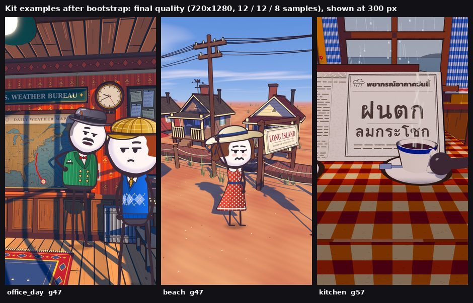
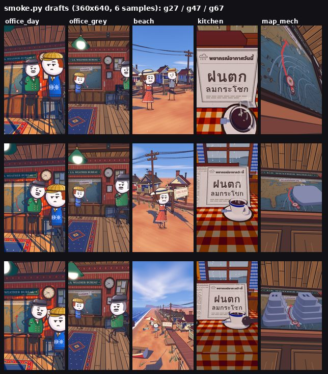

# The kit: make a shot today with what is bundled

From the unpacked skill to a rendered draft of a new shot in the film's style in under an hour. Everything here was run on a
fresh `scripts/bootstrap.py` project; the worked shots are `pipeline/examples/` (after bootstrap: `<PROJ>/examples/`).

**Rules in brief**
1. The skill ships code, specs and example takes, not caches: run `sh examples/setup_kit.sh` once after bootstrap (78 s measured from clean, about 150 MB written).
2. A shot is one Python file (`shot.py`) that a shared **runner** imports and drives: copy the example of your family, never the runner.
3. Five families, four runners: office_day and office_grey/storm (`otake.py`), beach (`bshot.py`), kitchen (`kshot.py`), map mechanism (`mc.py`).
4. Film frame `g` is 0-based (`g / 30` s); Blender frame `f = g + 1`; an event at narration clock `t` is on `round((t + 0.1) * 30)`.
5. Render `[G0 - H_IN, G1 + H_OUT)`: the shot plus handle frames that the conform mixes under dissolves.
6. Worker order: `probe` (numbers, no render) -> `stills`/`draft` (360x640, 6 samples) -> look -> `render` (720x1280, 12 samples) -> `post` -> `contact` -> `qa`. `draft` and `render` skip frames whose PNG and json exist with the same `VERSION` (and scale, samples): after changing `cam()`, poses or props, bump `VERSION` or delete `work/draft` before drafting again, or you look at (and measure) the old frames.
7. Stage with numbers before rendering: in a two-shot the near head 210-310 px wide and the far head 150-230 px (`spec/LOOK_SPEC.md`), near/far 1.36-1.46; main head centre 0.35-0.59 of the height; whole heads above y 880.
8. The camera never parks (static at most 6 frames), never moves at constant speed, and changes framing every 0.6-1.6 s.
9. Copy named marks and framings from the set APIs, and check them against `A['cams']` / `PA['cams']` in `setup()`.
10. Takes become a film with `examples/film_mini.py` (conform with every join type, grade, captions, mix); film 1's `v3/film/out/conform.py`, `out_v11/grade.py` (run as a script) and `out_v11/make_sharp.py` are hard-wired to film 1.



## 1. What ships, what you regenerate, what the machine needs

### 1.1 Shipped and not shipped (Our build, checked on a fresh bootstrap)

| Item | Shipped? | Where it comes from |
|---|---|---|
| set, stage, cast, acting, light, props, mech, beach, kitchen code | yes | `pipeline/v3/...` |
| nine of film 1's takes: s10, s11, s13, s14, s17, s19, s20, s24, s26 (`shot.py`, `meta.json`, `cues.json`, `QA.md`; runners `s10/otake.py`, `s14/otake.py`, `s17/otake.py`, `s20/mc.py`) | yes, no frames | `pipeline/v3/film/sNN/` |
| office textures `v3/set3d/tex/` | no | `python3 v3/set3d/textures.py` (also lazily on first build) |
| paper artwork `v3/paper/tex/` (spinner disc, label, calendar, newspaper, forecast sheet) | no | `python3 v3/paper/paper.py build` (never lazy) |
| grey and storm skies and rain loops `v3/set3d_ext/light/tex/` | no | `python3 v3/set3d_ext/light/gen_tex.py` (never lazy) |
| 6000 px wall map `v3/set3d_ext/props/tex/map_6000.png` | no | `python3 v3/set3d_ext/props/make_hi_map.py 2000` (lazy when `hi_map=True`) |
| derived prop textures (fast spinner, ruler, smudge, ink bloom) | no | written on the first `office_props.build` |
| beach textures `v3/set3d_beach/tex/` | no (3 ext cards are) | `python3 v3/set3d_beach/beach_tex.py` (also lazy) |
| kitchen textures and sequences `v3/set3d_kitchen/tex/` | no | `python3 v3/set3d_kitchen/kitchen_tex.py` (also lazy) |
| mech cards `v3/set3d_ext/mech/tex/` | yes (5 PNG) | |
| puppet sprites | no | each take writes its own into `<take>/work/sprites/` |
| fonts | yes: `fonts/Kanit_900Black.ttf`, `fonts/WorkSans-Black.ttf` (captions); `fonts/th/Kanit_800ExtraBold.ttf`, `fonts/th/Kanit_900Black.ttf` (paper artwork, SIL OFL) | `pipeline/fonts/` |
| film 1 narration WAV, sound-effect WAVs | no | `audio/build_narration.py`, `audio/sfx/make_sfx.py` (fal.ai, paid) |

### 1.2 Environment (versions of the tested machine)

| Need | Tested version | Check |
|---|---|---|
| Blender as the Python module `bpy` | 5.3.0 on Python 3.13 | `python3 -c "import bpy; print(bpy.app.version_string)"` |
| Python packages | numpy 2.5.3, Pillow 12.3.0, opencv 5.0.0, fontTools 4.68.0 (paper.py) | `check_env.sh <PROJ>` tests all of them |
| node + Playwright with Chromium (SVG -> PNG) | node 22, playwright 1.63.0 | all rasterisers pass `NODE_PATH` and default it to `/opt/node22/lib/node_modules`; set `NODE_PATH=$(npm root -g)` elsewhere |
| ffmpeg with libx264 and libass | 6.1.1 | captions and mux |
| system fonts | Loma Bold (`/usr/share/fonts/opentype/tlwg/Loma-Bold.otf`), DejaVu, Liberation | typed Thai and Latin on paper props |
| cores | 4 | renders use 2 threads each; two at a time |

`sh scripts/check_env.sh <PROJ>` prints one line per need, including fontTools, NODE_PATH, the system fonts and the Kanit files under `<PROJ>/fonts` (it also tests fal.ai with a free 422 call).

### 1.3 Clean start, in order (measured on the fresh project)

```sh
python3 <skill>/scripts/bootstrap.py <PROJ>   # under 0.5 s; 282 files at this check (the count follows the bundle)
sh <skill>/scripts/check_env.sh <PROJ>
cd <PROJ> && sh examples/setup_kit.sh         # 78 s from clean; 2 s when everything is cached except gen_tex (14 s, always rewrites)
cd examples && python3 smoke.py               # 41-45 s: "smoke: ALL PASS"
```

| Step inside `setup_kit.sh` | Time | Size | Order constraint |
|---|---|---|---|
| `fonts/th/`: shipped; a missing file is filled with a copy of Kanit Black | 0 s | 0.3 MB | before paper.py |
| `python3 v3/set3d/textures.py` | 3.1 s | 4.8 MB | first |
| `python3 v3/paper/paper.py build` | 42 s | 62 MB | before any office or kitchen build |
| `python3 v3/set3d_ext/light/gen_tex.py` | 14 s | 36 MB | after set3d textures (it recolours `sky.png`) |
| `python3 v3/set3d_ext/props/make_hi_map.py 2000` | 5.3 s | 11 MB with derived props | after set3d textures |
| `python3 v3/set3d_beach/beach_tex.py` | 1.1 s | 0.3 MB | |
| `python3 v3/set3d_kitchen/kitchen_tex.py` | 13 s | 34 MB | |

What breaks if a step is skipped (seen in the test): without `paper.py build` the office props silently use magenta-striped
`PLACEHOLDER_*.png` cards (the spinner disc showed as a pink square on the map); without `fonts/th/` `paper.py` stops with
`FileNotFoundError ... fonts/th/Kanit_800ExtraBold.ttf`; without the light textures `office_light` raises `FileNotFoundError (run gen_tex.py)`.

## 2. The five families



| Family | Example | Runner | Set build the runner does | Light names | Performers it supports |
|---|---|---|---|---|---|
| office, day | `examples/office_day/shot.py` | `v3/film/s10/otake.py` | `office3d.build("INTERIOR_DAY")`, `office_props.build` | office_day only (hard-coded) | puppets on cards, pinned hands, plate/matte streak |
| office, grey or storm | `examples/office_grey/shot.py` | `v3/film/s17/otake.py` | the same + `office_light.apply(LIGHT)`, `tint_cards()` for storm, `post_build` hook, sprite `overlay` | `LIGHT` = office_day, office_grey, office_storm | the same + note glyph overlays |
| beach | `examples/beach/shot.py` | `v3/set3d_ext/beach/bshot.py` | `beach_ext.build(LIGHT)` | beach_sunny, grey_drizzle, storm_approach, storm | puppets; head ink side flipped from the key automatically |
| kitchen | `examples/kitchen/shot.py` | `v3/set3d_kitchen/kshot.py` | `kitchen3d.build(LIGHT)` | kitchen_grey, kitchen_storm | the ink arm card only (insert set, no room for puppets in its framings) |
| map mechanism | `examples/map_mech/shot.py` | `v3/film/s20/mc.py` | office + props (`hi_map=True`) + `office_mech.build(wall_height=0.50)` + `office_light.apply('office_grey')` | office_grey (`mc.LIGHT`) | none: lens 0.35-1.8 D from the map, puppets are about 4 D tall |

Every example: 36 film frames (g 30..65) + 3 + 3 handles, one move between two named framings, one gimmick, `CUES`.

| Example | Marks (scene units D) | Framings (loc -> look_at) | Acting | Gimmick |
|---|---|---|---|---|
| office_day | chief `boss_mark` (1.30, -0.42, 0); hero `gloat_near` (2.40, -1.70, 0) | `low_boss` (1.92, -4.40, 1.2) -> (1.45, -0.42, 2.27); snap g 40-52 into `G` (1.55, -4.95, 2.85) -> (1.25, -0.40, 2.62); zoom 22 -> 25 mm | `boss_talk(t, LOUD, base=boss_finger_wag(...))`; `hero_listener` | `S.set_track(0.55 -> 1.0)`; `X.set_spinner` |
| office_grey | hero `hero_mark` (-0.55, -0.42, 0); chief walks (3.55, -1.35) -> `near_mark` (2.6, -1.95, 0) | `eye_two_shot` (1.45, -6.2, 2.55) -> (1.3, -0.5, 2.3); crane g 36-60 into `high_two_shot` (1.8, -5.9, 3.7) -> (1.35, -0.6, 1.55) | `boss_walk` (2 steps of 0.68 s, lands on contact, settles 5 frames); `hero_slumped` | `OL.set_rain`, `X.set_label(flutter=...)`; storm `OL.lightning(f)` |
| beach | `sand_a` (0, 7.6, 0); `sand_b` (2.5, 8.4, 0) | `eye_beach` (3.6, 13.2, 2.75) -> (1.0, 7.6, 2.15); crash pull-out g 44-60 into `vista_high` (-13, 8.2, 6.2) -> (30, 1.6, 0.6), lifted 0.8 D mid-move over the lifeguard chair | `beach_shrug`; `beach_hold_hat(gust_at=...)` | `state()`: wind, sign_sw, vane |
| kitchen | cup handle in world space from `CUP_REST`, `HANDLE`, `CUP_ROT`; shoulder (1.55, -2.05, 2.05) off frame | `steep` (0.225, -1.62, 2.30) -> weather box; ease g 32-54 into `table` (0.225, -2.42, 1.80) -> (0.225, -0.30, 1.07) | `arm(g)` -> `{hand, shoulder}` | `state()`: cup rattle, ripple, steam loop, drizzle, flutter |
| map_mech | spinner at u 0.10 (`M.world(0, 0, 0.02, u=0.10)`) | `M.cam('rake_spinner')` -> snap g 36-48 (`mc.snap_e`, `mc.blend`) -> `M.cam('rake_north')` | none | `M.set_wall('E'/'W', rise=0 -> 4)`, `M.set_lane(grow)` |

### 2.1 Commands per family, in a worker's order

All from the example's folder. `a:b` frame ranges are film frames.

| Step | office (otake) | beach (bshot) | kitchen (kshot) | map_mech (mc) |
|---|---|---|---|---|
| probe | `probe 27:68:8` prints camera z, pitch, each head `w (x, y) top bot`, pinned-hand error | `probe 27:68:10` JSON per frame -> `work/probe.json` | none; `still 47 50 6` | `probe 27:68 10` (spinner and N.Y. on screen) |
| look | `stills 40,52` -> `work/stills.jpg` | `still 47 0.5 6` | `still 47 50 6` | `still 40,52 draft` |
| draft | `draft 27:68` -> `work/draft/f_%04d.png`, `work/draft_sheet.jpg` | `draft 27:69:1` -> `work/draft/g_%04d.png`, `work/draft_contact.jpg` | `draft 27:69:1` -> `work/draft/g_%04d.png` | `draft 27:69:1` -> `work/draft/g_%04d.png` |
| render | `render` -> `work/raw/f_%04d.png` + `meta/`, `plate/`, `matte/` (fast frames) | `render` -> `raw/g_%04d.png` + `raw/meta`, `plate/`, `matte/` | `render` -> `raw/` (8 samples) | `render` -> `frames/g_%04d.png` + `work/meta` |
| post | `post` -> `frames/g_%04d.png`, `meta.json`, `cues.json`, `work/post_log.json` | `post` -> `frames/` | `post` -> `frames/` | `post` (in the example) -> `meta.json`, `cues.json`, `contact.jpg` |
| contact, qa | `contact` -> `contact.jpg`; `qa` -> `work/qa.json` + hue report | `qa` -> `meta.json`, `cues.json`, `contact.jpg`, `work/qa.json` | `qa` (kqa.py) -> the same four | `motion` -> `work/motion.json` |

Ranges: otake takes `a:b[:s]` inclusive or `a,b,c`; bshot, kshot and mc take `a:b:s` with `b` exclusive. otake names raw
files `f_%04d` with `f = g + 1`; every `frames/` folder uses `g_%04d` with the film frame.

Measured (2 threads): a draft frame 1.4-1.9 s wall after a 2-7 s build; final office_day g47 10.5 s wall, 21.4 s CPU (12 samples);
beach g47 11.6 s plus a plate and matte pass (a fast frame); kitchen g57 6.4 s (8 samples). The examples' `qa` found: office_day
one 22 px/frame snap peak, no pops, heads chief 173-196 px and hero 244-283 px wide; office_grey one static run of 5 frames at the
start of the creep (allowed: at most 6).

## 3. How a shot file is built (annotated template, otake family)

Copy `examples/office_day/shot.py` and change the marked parts. The other runners read the same ideas under other names (table 3.1).

```python
import os, sys, math
DIR = os.path.dirname(os.path.abspath(__file__))              # the runner writes work/, frames/, meta.json, cues.json here
sys.path.insert(0, os.path.dirname(DIR)); import common as C   # examples/common.py: PROJ, gf, gb, synth_loud, creep, blend_cam
sys.path.insert(0, os.path.join(C.PROJ, "v3", "film", "s17")) # the runner: s10 (day only) or s17 (LIGHT switch)
import otake as O                                             # imports first: it puts acting, stage, set3d, props on sys.path
import acting as AC, office3d as S, office_props as X

TAKE, SHOTS, VERSION, HI_MAP = "s07", [7], 1, False            # VERSION: bump to make `render` redo every frame
LIGHT = "office_grey"                                         # s17 runner only
G0, G1 = C.gb(12.30), C.gb(14.10)                             # shot boundaries from the narration clock (round(t * 30))
H_IN, H_OUT = 7, 7                                            # handles: half the dissolve plus 2 (film 1: 9-frame dissolve -> 7)
TRANSITION_IN = dict(type="dissolve", frames=9, note="...")   # read by the conform from meta.json (cut, dissolve, ...)
SNAP = (C.gf(12.80), C.gf(13.20))                             # in-shot events from the narration clock (round((t + 0.1) * 30))

def setup(T): ...                                             # after set + props (+ light), before the camera is keyed: check framings
def post_build(T): ...                                        # s17 only: after the actor cards exist (rain levels, lightning keys)
def cam(g):                                                   # -> (loc, look_at, up or None, lens mm) of film frame g; pure function
    ...
def props(g, f):                                              # every prop setter for frame g with frame=f (= g + 1): keyed, not set
    S.set_track(1.0, 0.0, frame=f)
def boss_pose(g):                                             # -> (pose dict, hands or None); hands = {'l': {'tip': world xyz, 'prop', 'angle'}}
    return AC.boss_talk((g - G0) / 30.0, LOUD, base=...), None
ACTORS = [dict(name="boss07", cast="boss", place=lambda g: ((1.30, -0.42, 0.0), False),   # (feet xyz, flip)
               pose=boss_pose, ppd=320)]                      # ppd: sprite px per D (examples: 256-384 for heads of 173-283 px, i.e. 1.3-2 x the head width, inferred); may be g -> int
               # optional: hidden=g -> bool, yaw_fixed=g -> deg, canvas=(x0, y0, x1, y1), overlay=fn(frame, pose) -> svg (s17)
               # canvas: REQUIRED for any cast other than hero and boss in otake: sprites.DEFAULT_CANVAS holds only those two and
               #   otake does not import cast_ext. Pass the cast's own row of cast_ext.CANVAS (characters-acting 2.2), e.g.
               #   clerk canvas=(-1.8125, -4.5625, 1.8125, 0.125); those rows already leave room for steam, Z and sweat.
CUES = [(12.80, 0.4, "whoosh", "whoosh on the snap")]         # (narration clock s, duration s, kind, label) -> cues.json at clock + 0.1
if __name__ == "__main__":
    O.run(sys.modules[__name__], sys.argv[1:])
```

What the runner does per frame: in `Take.__init__` it builds the scene once, calls `setup`, then for every rendered frame keys
the camera from `cam(g)` (constant interpolation), calls `props(g, g + 1)` and keys each actor's `place(g)`; `pose()` then calls
`pose(g)` per frame, solves pinned hands against that frame's camera and rasterises the sprites in chunks of 12 frames; `render`
renders, then writes `meta/g_%04d.json` with the `report()` numbers. A frame counts as done only when its PNG and json exist
with the same scale, samples and `VERSION`, so `render` can be killed and restarted. `draft` uses the same test on `work/draft`: it silently reuses old draft frames after an edit unless `VERSION` changes.

Time, in one place: `G0`/`G1` are shot boundaries (`gb(t) = round(t * 30)` of the narration clock), events inside a shot use
`gf(t) = round((t + 0.1) * 30)` because the narration is laid 0.100 s into the film; acting functions take local seconds
`t = (g - g_start) / 30`; mouths take `acting.loudness(t0, t1, path=<wav>)`, one value per frame from film frame `gf(t0)`.
Handles are frames rendered outside `[G0, G1)` so the conform can mix a dissolve of L frames on `gb - L//2 .. gb - L//2 + L - 1`
from both takes; a hard cut needs 0 handles.

### 3.1 The same contract in the other runners

| Item | otake (office) | bshot (beach) | kshot (kitchen) | mc (map mech) |
|---|---|---|---|---|
| range | `G0, G1, H_IN, H_OUT` | + `R0, R1` | + `R0, R1` | `G0, G1, H_IN, H_OUT` |
| light | s10: fixed day; s17: `LIGHT` | `LIGHT` (plan name) | `LIGHT` | `mc.LIGHT` = office_grey |
| camera | `cam(g)` -> (loc, look, up, lens) | `cam(g)` -> (loc, look), 22 mm | `cam(g)` -> (loc, look), 22 mm | `cam_setup(g)` -> {loc, look_at, lens, up, roll} |
| set state | `props(g, f)` (keys) | `state(g)` -> dict (fog, rain, wind, sea, wave, sign_sw, windows, shutters, spider, towel_on, vane, fog_r) | `state(g)` -> `kitchen3d.set_state` kwargs | `state(g)` sets mech setters directly; `apply(g)` = state + camera |
| actors | `ACTORS` with `place`, `pose` callables | `ACTORS` list + `actors(g)` -> {name: dict(feet, pose, flip, hands) or None} | `arm(g)`, `cup_in_hand(g)` | none |
| extras | `setup`, `post_build`, `apply`, `WHOLE_STREAK`, `META_NOTE` | | | `probe_frame(g)` |

## 4. From takes to a film

Film 1's `v3/film/out/conform.py` joins the hook and takes s04-s26 into exactly 1965 frames, with film 1's overlays at fixed
frames: it cannot be pointed at new takes without editing `TAKES`, `N`, `load_takes` and `build`. `examples/film_mini.py` does
the same three steps for any list of finished take folders, with conform.py's dissolve rule:

```sh
cd <PROJ>/examples
python3 film_mini.py conform ../film_test office_day beach kitchen   # frames/f_%04d.png, joins.json, cues_all.json
python3 film_mini.py grade ../film_test [shots.json] --procs 3       # graded/f_%04d.png: the v1.1 grade, DEFAULT settings only
python3 film_mini.py captions ../film_test caps.json --style th88 --frames graded   # film_silent.mp4 via ../assemble.py (captions last)
python3 film_mini.py mix ../film_test mix.json                        # film.wav, film.mp4 via ../audio/mixer.py
```

- conform: reads each take's `meta.json` and `frames/`; `transition_in.type`:
  `dissolve` L on `gb - L//2 ..`, incoming weight `smoothstep((g - a + 1) / (L + 1))`; `wipe` (or `object_wipe`) = conform.py's
  6-frame foam wipe `C.foam_wipe` on gb-3..gb+2 (3 handle frames each side); `flash` = cut at gb with white 0.15/0.35/0.60/0.85/1.00
  on the last 5 outgoing frames and 0.85/0.55/0.30/0.12 on the first 4 incoming; `punch_in` = cut plus `C.speed_lines` on the first
  6 incoming frames (strength 0.45, n 40, r_in 300, centre `transition_in["centre"]`, default (360, 520)); `cut`, `hard_cut`, `whip`,
  `hidden_cut_in_whip` = cut (a whip's streak is rendered in the takes). Any other type stops the conform with an error. Takes on one narration clock keep their frame numbers; takes that do not follow each other (the examples
  all sit on g 30..66) are laid back to back and the shifts are written to `joins.json`. Cues of every take are shifted the same way into `cues_all.json`.
- grade: `grade.py`'s `grade_frame` with `DEFAULT` settings only (the curve knots of colour-light 3, `SAT_GLOBAL` 1.18, hot bloom,
  red protect 0.8, white protect wsat 0.30, soft ceiling 0.985); film 1's `TAKES`, `JOINS`, `SHOT` and fog bank are replaced by this
  film's `joins.json`, no per-shot entries and no fog. Optional `shots.json` = `{"<take>": {"sat": 1.1, ...}}` with `grade.DEFAULT`
  keys: per-take corrections that cross-fade over the joins. Resumable. Never run `grade.py` itself on a new film: its tables are film 1's
  (it would put s16's sat 1.60 and gain 0.88 on frames 1013-1085 of the new film).
- captions: `caps.json` = `[{"t0": 0.0, "t1": 0.6, "text": "หัวหน้าบอกว่า"}, ...]` on the film clock; `--style` `th88` =
  `{\fnKanit Black\fs88}` (film 1, 45 px text height), `th72` = `{\fnKanit Black\fs72}` (37 px, the reference size), `en` =
  `{\fnWork Sans Black\fs58}` (36 px, stroke 3.8 px, measured with score.py); `assemble.py` places it at (360, 900), hard swaps,
  fonts from `<PROJ>/fonts`. `--frames graded` burns over the graded frames (default `frames`).
- mix: `mix.json` is `audio/mixer.py`'s spec without duration and video: `{"voice": {"file", "at", "gain"}, "music": {"file", "at", "rms_db": -38, ...},
  "sfx": [{"file", "at", "peak_db" | "rms_db", ...}]}`; build `sfx` from `cues_all.json`.

Tested on the three example takes: 108 frames, 3.60 s, dissolves on g 34-38 and 70-74, 7 cues; conform 27 s, captions 3 s;
720x1280 H.264 with AAC, captions in Kanit Black seen on the frame at 2.3 s. The sound used ffmpeg stand-ins (`sine` voice,
`anoisesrc` whoosh and bed): no paid service was called. The joins and the grade were tested on three of film 1's takes
(s05 > s06 as `wipe`, s06 > s07 as `flash`, then as `punch_in`; an unknown type stops with an error): 59 frames conformed in 21 s,
graded in 12 s with `--procs 3`, English captions burned over `graded/`.

## 5. Problems found on the way, and the fix

| Problem (fresh bootstrap) | Fix | Where fixed |
|---|---|---|
| Film 1's takes fail on import: `acting.loudness()` opens `audio/th/full_v2/narration.wav`, not shipped | pass `path=` to your narration, or `common.synth_loud(seconds)` until the voice exists | examples; `acting.loudness` now names the missing file and the fix |
| `paper.py` needs `fonts/th/Kanit_800ExtraBold.ttf` and `fonts/th/Kanit_900Black.ttf` | both are now shipped in `fonts/th/`; `paper.py` names a missing font | fixed in the skill |
| Without `paper.py build` props use magenta-striped placeholder cards, silently | run it before the first office or kitchen render | `setup_kit.sh` |
| `office_light` needs `gen_tex.py` output; not lazy | run it after the office textures | `setup_kit.sh` |
| Rasterisers default `NODE_PATH` to `/opt/node22/lib/node_modules` | export `NODE_PATH=$(npm root -g)` | `setup_kit.sh` |
| `fontTools` is needed by `paper.py` | `pip install fonttools` | `check_env.sh` and `setup_kit.sh` check it |
| `s20/post.py` has a hard-coded take table (s20-s22) | the example's own `post` writes meta, cues, contact | `map_mech/shot.py`; `s20/post.py` now stops with that message for any other take |
| kshot has no `qa` command (kqa.py is separate) | `shot.py qa` calls `kqa.main(DIR)` | `kitchen/shot.py` |
| `bqa.py` asserts 720x1280 frames | only matters when drafts stand in for finals (`smoke.py --chain` scales them) | `smoke.py` |
| A linear creep under a hold shows as a "linear run" in `qa` | `common.creep(u)` = 0.4 u + 0.6 u^2 | all examples |
| `low_boss` also frames the hero at `gloat_near` (film 1's s10 used its own low single for that reason) | accept or use another first framing | noted in the example |

## Snippets run

All five `shot.py` files (probe, draft, chain: post, contact, qa), `setup_kit.sh` on a fresh bootstrap, `smoke.py` (default and
`--chain`), `film_mini.py` conform, captions and mix, `EX_LIGHT=office_storm` and `office_day` drafts of office_grey, three final
frames. Re-run in the fact check: `bootstrap.py` (282 files), `textures.py`, `paper.py build` (47 s), `office_day` `probe 27:68:20`
(heads chief 180-196 px, hero 264-277 px) and `draft 47` (1.5 s wall, 3.0 s CPU). Not run: `stills` of otake, the template in section 3 as written (it is the office_day file with names changed).

## Sources

`scripts/bootstrap.py`, `scripts/check_env.sh` (skill root); `v3/README.md`; `v3/film/s10/otake.py`, `s10/shot.py`, `s17/otake.py`,
`s17/shot.py`, `s14/otake.py`, `s20/mc.py`, `s20/shot.py`, `s20/post.py`, `s19/shot.py`, `s24/shot.py`, `s26/shot.py`, `sNN/meta.json`;
`v3/set3d/API.md`, `office3d.py`, `textures.py`, `raster.js`; `v3/set3d_ext/props/API.md`, `office_props.py`; `v3/set3d_ext/light/API.md`,
`office_light.py`, `gen_tex.py`; `v3/set3d_ext/mech/API.md`, `office_mech.py`; `v3/set3d_ext/beach/API.md`, `bshot.py`, `bqa.py`;
`v3/set3d_beach/API.md`; `v3/set3d_kitchen/API.md`, `kshot.py`, `kqa.py`, `kitchen_geom.py`, `kitchen3d.py`; `v3/paper/API.md`, `paper.py`;
`v3/acting/API.md`, `acting.py`; `v3/stage/API.md`; `v3/film/out/conform.py`, `CONFORM.md`, `sound/build.py`; `assemble.py`;
`audio/mixer.py`, `audio/sfx/make_sfx.py`; `examples/*` and their test runs.
